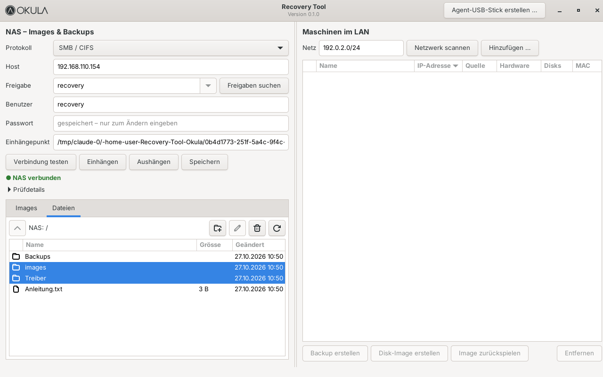
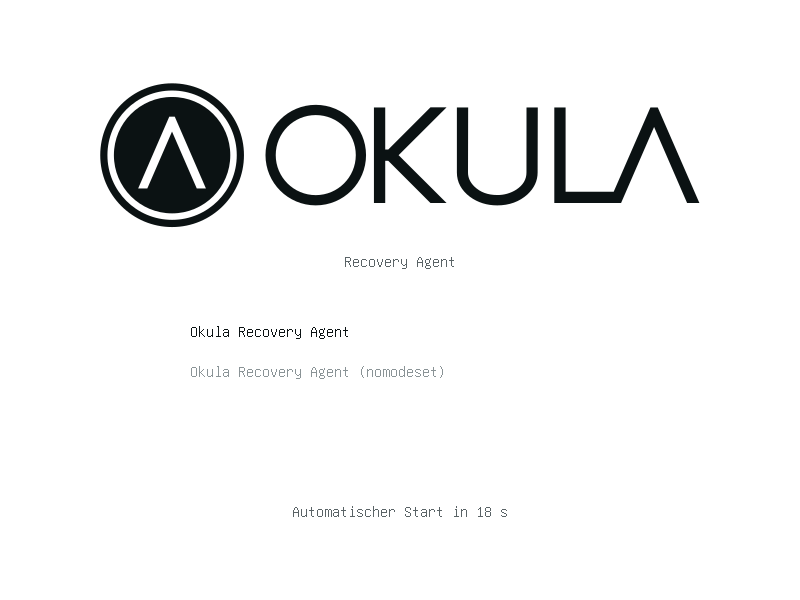
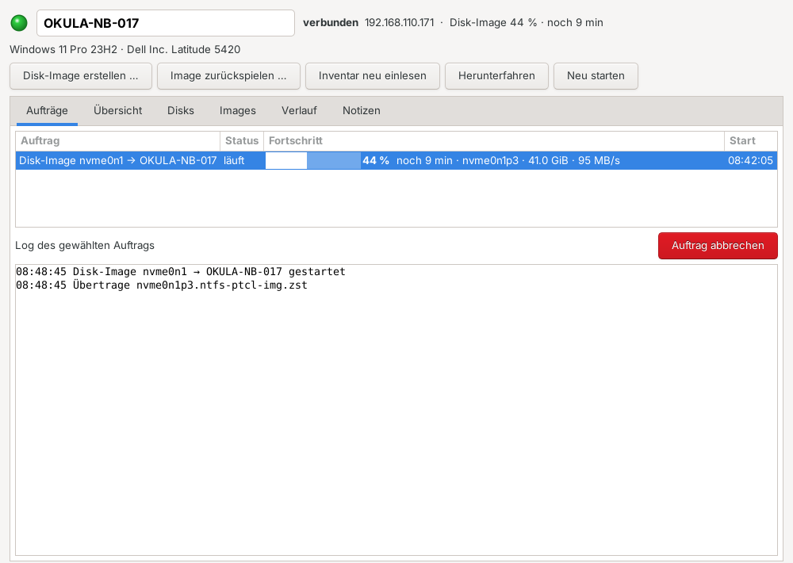
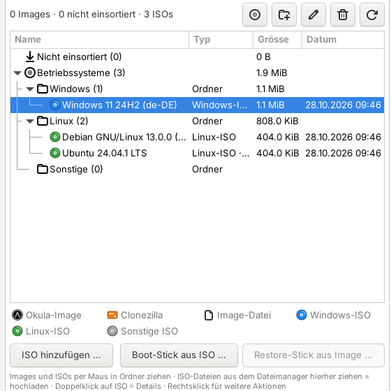
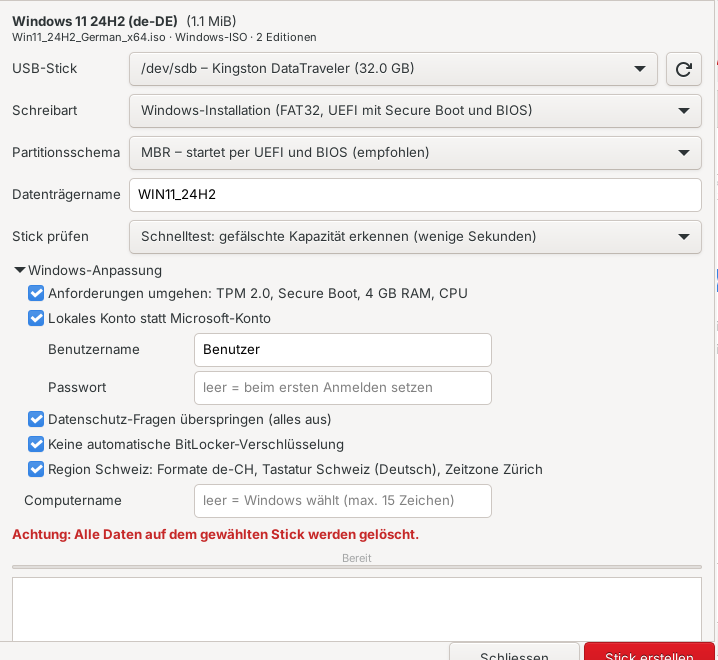
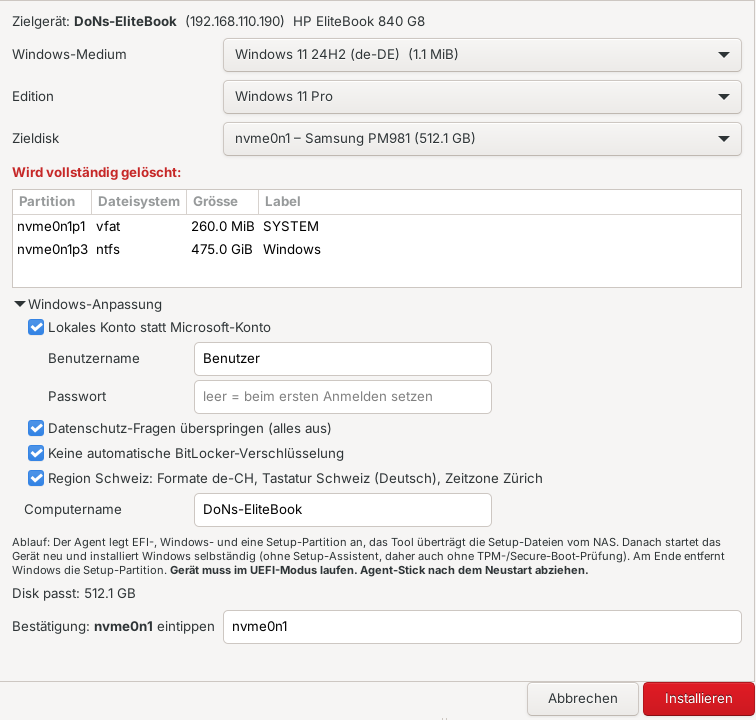
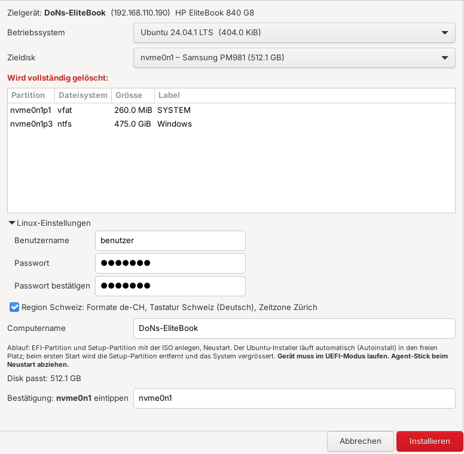

# Okula Recovery Tool

Backups und Disk-Images von Maschinen im LAN, gespeichert auf einem NAS.
Server: Debian 13 + Xfce, Python 3 + GTK 3.
Änderungen, Entscheidungen und offene Punkte: [docs/AENDERUNGEN.md](docs/AENDERUNGEN.md).



- **Menüleiste:**
  - **Menü:** NAS-Verbindung … (Ctrl+N), Einstellungen … (Automatisierung), Agent-USB-Stick erstellen …, Einstellungen exportieren / importieren …, Beenden
  - **Tools:** Gerät öffnen (Ctrl+O), Disk-Image erstellen, Image zurückspielen, OS installieren, Backup erstellen, Backup zurückspielen, Ordner senden, Automatisierung, Automatisierungen pausieren, Inventar neu einlesen, Gerät herunterfahren, Restore-Stick aus Image, ISO hinzufügen, Boot-Stick aus ISO, Netzwerkstart (PXE), Images aktualisieren (F5)
  - **Extras:** USB klonen, USB formatieren
  - **Hilfe:** **So funktioniert das Tool** (F1, Anleitung in einfacher Sprache mit Kapiteln), Tastenkürzel, Über
- **Links (Geräte):** Alle Geräte, die je mit dem Agent-Stick gebootet wurden, in einer Ordnerstruktur. ● grün = verbunden, ● rot = nicht verbunden (Erklärung auch unter Hilfe → So funktioniert das Tool); dazu Status, Betriebssystem, zuletzt verbunden und IP. Details siehe [Geräte](#geräte).
- **Rechts (NAS):**
  - **Statuszeile:** ● grün = NAS verbunden, ● rot = nicht verbunden bzw. nicht eingerichtet. Daneben der freie Speicher: grün, wenn genug frei ist; rot, wenn weniger als 100 GB frei sind. Das Tool prüft den Status beim Start und danach alle 30 s.
  - **Reiter:** *Images* (Ordnerbaum, siehe unten), *Dateien* (Dateiverwaltung) und *Backups* (alle Datei-Backups).
- **NAS-Verbindung einrichten:** Menü → NAS-Verbindung … oder das Zahnrad in der Statuszeile. Das Fenster enthält Protokoll, Host, Freigabe (mit „Freigaben suchen“), Benutzer, Passwort, Einhängepunkt, die Buttons Testen, Einhängen, Aushängen und Speichern sowie die Prüfdetails.

## Server-Installation (Debian 13)

```bash
sudo apt install git
git clone https://github.com/donsimm/recovery_tool_okula.git
cd recovery_tool_okula
git checkout claude/blissful-goldberg-mo3xda   # bis zum Merge
sudo ./install.sh --autostart
```

`install.sh` installiert die Pakete, kopiert das Tool nach `/opt/okula-recovery` (gehört root), legt den Root-Helfer `/usr/local/sbin/okula-make-stick` samt sudo-Regel für deinen Benutzer an, erstellt den Menüeintrag und mit `--autostart` den Start nach dem Login.

Starten: Menü → System → *Okula Recovery Tool* oder `cd /opt/okula-recovery && python3 -m okula_recovery`.
Update: im Repo `git pull`, dann wieder `sudo ./install.sh`.

### NAS einrichten (z. B. Synology)

Im NAS (Synology DSM: Systemsteuerung):
1. **Freigegebener Ordner** anlegen, z. B. `recovery`.
2. Eigenen **Benutzer** anlegen (nicht den Admin) und ihm Lese-/Schreibrecht nur auf diese Freigabe geben.
3. **Dateidienste → SMB** aktivieren, Mindestversion SMB2 (Standard in DSM 7).

Im Tool unter Menü → NAS-Verbindung …:
1. Host (IP des NAS), Benutzer und Passwort eingeben.
2. **Freigaben suchen**, dann die Freigabe aus der Liste wählen.
3. **Einhängen**. Bei Erfolg zeigt die Statuszeile rechts „● NAS verbunden“, und das Tool listet die Images.

Das Passwort speichert nur der Root-Helfer, in `/etc/okula-recovery/nas.cred` (root, `0600`). Es steht nie in der Konfiguration oder in Prozess-Argumenten. Nach dem nächsten Start hängt das Tool das NAS automatisch wieder ein. Fehlermeldungen von `mount` und `smbclient` werden als Hinweis angezeigt, etwa bei einem falschen Passwort, einer fehlenden Freigabe oder einer unpassenden SMB-Version.

Für NFS gibst du als Freigabe den Exportpfad an (z. B. `/volume1/recovery`) und erlaubst im NAS die IP des Servers.

### Images in Ordner einsortieren

Der Reiter *Images* zeigt einen aufklappbaren Baum:
- **Nicht einsortiert** steht ganz oben, neueste zuerst. Hier landen neue Images und alle, die noch in keinem Ordner liegen, auch bestehende Clonezilla-Images.
- **Eigene Ordner** mit bis zu **3 Ebenen**, z. B. *Kunde › Standort › Gerät*. Anlegen, Umbenennen und Löschen über die Knöpfe oder per Rechtsklick. Ein Ordner lässt sich nur löschen, wenn er leer ist.
- **Icons:** OKULA-Emblem = mit diesem Tool erstelltes Image, orange Disk = Clonezilla-Image, Datei-Symbol = einzelne Image-Datei (`.img`, `.dd` …). Eine Legende steht unter dem Baum.
- **Restore-Stick aus Image …:** Der Knopf steht unter dem Baum und ist aktiv, sobald ein Okula- oder Clonezilla-Image gewählt ist.
- **Einsortieren per Maus:** Ein Image auf einen Ordner ziehen oder zurück auf „Nicht einsortiert“. Ganze Ordner lassen sich ebenfalls in einen anderen Ordner ziehen, ohne die 3 Ebenen zu überschreiten. Rechtsklick → „Nach ‚Nicht einsortiert‘“ geht auch.

Die Ordner sind echte Ordner auf dem NAS unter `Archiv/`, z. B. `Archiv/Kunde A/Standort Zürich/PC-Buchhaltung/<Image>`. Verschieben ist ein Umbenennen auf derselben Freigabe und geht auch bei grossen Images sofort. Nicht einsortierte Images liegen unter `images/` (bzw. bei Clonezilla dort, wo sie abgelegt wurden).

### Dateien auf dem NAS verwalten

Rechts gibt es zwei Reiter:
- **Images:** Alle gefundenen Images. Ein gewähltes Image löschst du mit **Löschen**.
- **Dateien:** Dateiverwaltung der Freigabe. Ordner öffnest du per Doppelklick, ↑ oder Backspace führt eine Ebene zurück. Dazu kommen **Neuer Ordner**, **Umbenennen** (F2) und **Löschen** (Entf, mit Mehrfachauswahl).
- **Auf das NAS kopieren:** Dateien und ganze Ordner – z. B. **Clonezilla-Images** von einer externen Platte – aus dem Dateimanager in den Reiter *Dateien* ziehen (auf einen Ordner = dorthin, sonst in den offenen Ordner) oder über den Knopf **Hochladen** (Dateien … / Ordner …). Kopiert wird im Hintergrund mit Fortschritt, Tempo, Restzeit und Abbrechen; vorher prüft das Tool Platz und Namen (SMB-taugliche Zeichen). Bestehendes wird nie überschrieben („Name (2)“). Jeder Eintrag entsteht zuerst als versteckter `.Name.partial` und wird erst vollständig umbenannt – ein Abbruch hinterlässt nichts Halbes. Links werden übersprungen. Ein kopiertes Clonezilla-Image erkennt das Tool und zeigt es im Reiter *Images*.

Vor dem Löschen zeigt das Tool Anzahl und Grösse der Dateien und fragt nach. Das Tool hat keinen Papierkorb, gelöschte Daten sind weg. Falls im NAS ein Papierkorb für die Freigabe aktiv ist, greift dieser. Alle Aktionen bleiben innerhalb des Einhängepunkts: `..` und Links nach draussen werden abgewiesen, Links werden nie verfolgt.

Das Tool startet maximiert. **F11** schaltet auf Vollbild ohne Titelleiste und wieder zurück.

**Serverlast:** Oben rechts zeigt das Tool die Auslastung des Servers – CPU, RAM (ohne Cache) und LAN (↓ empfangen, ↑ gesendet) mit Verlauf der letzten Minute, gemessen jede Sekunde aus `/proc`. Maus darüber: Kerne und Last, Swap, Netzwerkkarte und Verbindungsgeschwindigkeit. Ab 90 % wird der Wert rot. Für die Kurven braucht es `python3-gi-cairo` (installiert `install.sh`).

## Umzug auf einen neuen Rechner

**Menü → Einstellungen exportieren …** speichert alles in eine Datei (`okula-recovery-<Rechner>-<Datum>.okula.zip`, nur für den Benutzer lesbar):
- `config.json`: NAS-Verbindung und Einstellungen
- `geraete/…`: Geräteverzeichnis mit Ordnern, Verlauf, Notizen und Windows-Schlüsseln
- `agent.key`: Schlüssel der Agent- und Restore-Sticks (empfohlen – sonst alle Sticks neu erstellen)

Nicht enthalten: Images, Backups und ISOs (bleiben auf dem NAS) sowie das **NAS-Passwort** – es liegt nur für root lesbar in `/etc/okula-recovery/nas.cred` und wird nach dem Import einmal im NAS-Fenster eingegeben. Die Datei enthält Schlüssel: wie ein Passwort aufbewahren.

Der Export enthält auch die Vorlagen der Automatisierung und die Einstellung „höchstens gleichzeitig“.

**Menü → Einstellungen importieren …** auf dem neuen Rechner (nach `sudo ./install.sh`): zeigt den Inhalt, Teile einzeln wählbar. Vorher sichert das Tool alles, was überschrieben werden könnte, nach `~/.config/okula-recovery/import-sicherung/<Datum>/`. Geräte werden zusammengeführt (gleiche ID: das zuletzt gesehene gewinnt, Ordner aus dem Export; gleiche Hardware mit anderer ID wird zu einem Eintrag vereint). Danach startet das Tool neu. Während Aufträge laufen, ist der Import gesperrt. Manipulierte Dateien (Pfade ausserhalb, falsche IDs, neuere Formatversion) werden abgewiesen.

**Nur NAS:** Im NAS-Fenster gibt es **Exportieren …** (JSON ohne Passwort) und **Importieren …** (liest auch den Gesamt-Export). Der Import füllt das Formular; danach Passwort eingeben und „Einhängen“.

## Agent-USB-Stick

Menü → **Agent-USB-Stick erstellen …**:

1. Stick einstecken und auswählen. Angeboten werden nur USB- und Wechseldatenträger, nie die Systemdisk.
2. Debian-Live-ISO wählen oder **Herunterladen** klicken. Das Tool lädt das aktuelle `debian-live-…-amd64-standard.iso` von cdimage.debian.org und prüft es gegen `SHA512SUMS`. Die Datei liegt danach unter `~/.cache/okula-recovery/iso`. Einen anderen Mirror setzt du über die Umgebungsvariable `OKULA_DEBIAN_LIVE_URL`.
3. **Stick vorbereiten**. Der Stick wird gelöscht und so aufgebaut:
   - MBR mit einer FAT32-Partition (Label `OKULAAGENT`), darauf der Inhalt des Live-ISO
   - eigene `grub.cfg`; gebootet wird per UEFI über den GRUB des ISO und per BIOS über `grub-install`
   - Agent als zusätzliches Image `/live/okula-agent.squashfs`. live-boot legt es über das Live-System, so sind Agent, systemd-Dienst und Banner beim Booten direkt aktiv. Auf der Zielmaschine wird nichts installiert, alles läuft im RAM.
   - Tastatur `ch`, Locale `de_CH.UTF-8`, Zeitzone `Europe/Zurich`



**Ablauf an der Zielmaschine:** vom Stick booten (Boot-Menü, meist F12/F11/F8). Der Agent sendet alle 3 s ein Beacon auf **UDP 47811**, und zwar per Broadcast und zusätzlich direkt an die Server-IP aus dem Dialog. Das Tool antwortet, die Konsole zeigt „Verbunden“, und das Gerät erscheint links mit grüner LED (neu: unter „Neu / nicht einsortiert“, siehe [Geräte](#geräte)).

- **Unbekannte IP:** Die IP muss niemand kennen. Die Zielmaschine bekommt im Live-System per DHCP eine neue IP, die alte Netzwerkeinstellung des installierten Systems spielt keine Rolle. Gibt es kein DHCP, setzt der Agent nach etwa 25 s eine feste Link-Local-Adresse `169.254.x.y` (aus der MAC) und meldet sich per Broadcast an `255.255.255.255`. Das Tool antwortet dann ebenfalls per Broadcast.
- **Firewall auf dem Server:** UDP 47811 eingehend freigeben (z. B. `sudo ufw allow 47811/udp`).
- **Secure Boot:** Der Stick nutzt die signierte Boot-Kette des Debian-ISO.
- **Hinweis:** Die Beacons sind nicht authentifiziert. Die spätere Steuerverbindung zum Agent bekommt eine Authentifizierung.

## Netzwerkstart (PXE) – Agent ohne Stick

Registrierte Geräte können den Agent **übers Netzwerk** starten (am Gerät F12/Boot-Menü → Netzwerk/PXE), statt vom Agent-Stick. **Nur** Geräte, die schon einmal mit dem Agent-Stick liefen **und** einzeln freigeschaltet sind, bekommen eine Antwort; alle anderen Rechner im Netz bleiben unberührt.

**Einrichten (Tools → Netzwerkstart (PXE) …):**
1. Server-IP wählen (Netz der Geräte) und das Debian-Live-ISO (wie beim Agent-Stick, ggf. **Herunterladen**).
2. **Vorbereiten:** legt Live-System, Agent-Teil (mit Schlüssel, partclone usw.) und die signierten Bootlader bereit (`/var/lib/okula-recovery/pxe`). Nach einem Tool-Update oder neuer Server-IP erneut vorbereiten.
3. Geräte freischalten: Haken in der Liste oder im Gerätefenster (Reiter *Netzwerk*, Zeile *Netzwerkstart*: Schalter Ein/Aus, daneben das Zahnrad zu den PXE-Einstellungen). Der Schalter ist ausgegraut, solange der Netzwerkstart nicht eingerichtet und eingeschaltet ist oder keine Kabel-Netzwerkkarte bekannt ist. Neu erfasste Geräte sind nie freigeschaltet.
4. **Einschalten.** Der Dienst läuft danach auch nach einem Neustart des Servers, bis er ausgeschaltet wird.

**Wie es abgesichert ist:**
- Das Tool vergibt **keine IP-Adressen** und macht kein DNS: `dnsmasq` läuft nur als *Proxy-DHCP* (`dhcp-range=…,proxy`, `port=0`). Der normale DHCP-Server bleibt zuständig.
- Proxy-DHCP und TFTP antworten nur MAC-Adressen in der Freigabeliste (`dhcp-hostsfile` mit Merkmal `okula`, `dhcp-ignore=tag:!okula`); es werden nur kabelgebundene Netzwerkkarten freigeschaltet. Fremde Rechner, die per Netzwerk starten, bekommen keine Antwort (getestet in QEMU).
- Den Agent-Teil (enthält den Agent-Schlüssel) liefert ein eigener HTTP-Dienst (Port 47813) nur aus, wenn die MAC der anfragenden IP (ARP-Tabelle) freigeschaltet ist; er kennt nur zwei feste Dateien. Der Schlüssel liegt nur für root lesbar auf dem Server.
- Bootlader: `shim`, `grub` (signiert – **Secure Boot** darf an bleiben) und `pxelinux` (BIOS) kommen aus den Paketquellen des Servers. Sie werden nur heruntergeladen und ausgepackt, nicht installiert – der Bootlader des Servers bleibt unberührt.

**Technik:** UEFI: shim → grub → Kernel/initrd per TFTP; BIOS: pxelinux. Das initrd ist das des Live-ISO plus ein kleines Skript, das live-boot anweist, neben `filesystem.squashfs` auch den Agent-Teil per HTTP zu laden – danach läuft alles wie mit dem Stick. Dienste: `okula-pxe.service` (dnsmasq), `okula-pxe-http.service`; gesteuert über den bestehenden Root-Helfer (`okula-make-stick pxe …`).

**Firewall auf dem Server:** eingehend UDP 67, 69 und 4011 (Proxy-DHCP, TFTP) sowie TCP 47813 (HTTP) freigeben, z. B. `sudo ufw allow 67,69,4011/udp && sudo ufw allow 47813/tcp`.

**Voraussetzungen am Gerät:** Netzwerkkabel (kein WLAN), Netzwerkstart im BIOS aktiv. Liegen Router/VLANs zwischen Gerät und Server, braucht es eine DHCP-Weiterleitung (IP-Helper) zum Server. Die Geräte brauchen genug RAM für das Live-System (wie beim Stick, ca. 2 GB).

### Fernsteuerung: Wake-on-LAN und „Netzwerkstart zuerst“

Im Gerätefenster, Reiter **Netzwerk** (dort auch Netzwerkstart-Schalter und Netzwerkkarten):

- **Einschalten (Wake-on-LAN):** sendet ein Magic Packet an die Kabel-Netzwerkkarten (Broadcast in die Netze des Servers und an 255.255.255.255, UDP 9 und 7). Am Gerät muss Wake-on-LAN im BIOS/UEFI aktiv sein; das Gerät muss im selben Netz sein (Router leiten Broadcasts nicht weiter).
- **Netzwerkstart zuerst:** Während das Gerät mit dem Agent verbunden ist, setzt der Agent den Netzwerkstart (PXE IPv4) an die erste Stelle der UEFI-Startreihenfolge (`efibootmgr`); die bisherige Reihenfolge merkt sich das Tool zum Zurückstellen. Danach fragt das Gerät bei jedem Start zuerst das Tool:
  - ohne Auftrag (**Startart lokal**): grub bzw. pxelinux starten sofort von der Festplatte weiter (UEFI: zurück an die Firmware → nächster Starteintrag, z. B. Windows),
  - mit **„Beim nächsten Start den Agent laden“** (**einmal Agent**): der Agent startet; sobald er seinen Agent-Teil geladen hat, steht das Gerät wieder auf „lokal“.
  - **Einschalten und Agent starten** = Agent vormerken + Wake-on-LAN – das Gerät meldet sich danach im Tool, ohne dass jemand hingeht.
- Nur UEFI (BIOS-Geräte: Reihenfolge im BIOS-Setup). Windows-Updates können die Reihenfolge zurücksetzen – das Tool prüft sie bei jeder Verbindung (Knopf **Prüfen**) und meldet, wenn das Netzwerk nicht mehr vorne steht. Ist der Server aus, wartet das Gerät kurz aufs Netzwerk und startet dann normal.
- Die Startart pro Gerät setzt der Netzwerkstart-Dienst über je eine kleine Datei pro MAC (grub: `source /okula/mode/<MAC>`, pxelinux: `pxelinux.cfg/01-<MAC>`); getestet in QEMU mit UEFI/Secure Boot und BIOS.

> Für „Netzwerkstart zuerst“ braucht der Agent die neue Funktion: **Agent-Stick neu erstellen** und unter Tools → Netzwerkstart **neu vorbereiten**.

## Geräte

Bootet ein Gerät vom Agent-Stick, sammelt der Agent einmal das **Inventar** und das Tool legt das Gerät an bzw. erkennt es wieder.

- **Inventar:** Hersteller, Modell, Seriennummer, System-UUID, Gehäuse, Mainboard, BIOS, Prozessor, RAM, Akku (Zustand in %), Netzwerkkarten (MAC), Disks mit Seriennummer und SMART (Zustand, Betriebsstunden, Temperatur), BitLocker-Partitionen und das **installierte Betriebssystem** (Windows-Version und Computername aus der Registry, Linux aus `os-release`). Dafür hängt der Agent die Partitionen **nur lesend** ein (ext4 `noload`, NTFS `ro`, kein Journal-Replay); auf der Disk wird nichts verändert.
- **Wiedererkennung:** über die System-UUID, sonst Hersteller + Seriennummer, sonst MAC. Nach einem Board-Tausch hilft die Disk-Seriennummer. Eine MAC allein verbindet keine zwei Geräte mit verschiedener UUID (geteilter USB-Netzwerkadapter).
- **Doppelt erfasst?** Einträge mit gleicher System-UUID (z. B. nach einem Import, wenn das Gerät auf dem neuen Server schon vorher gestartet wurde) führt das Tool beim Start und beim Import automatisch zusammen. Von Hand: Rechtsklick auf den doppelten Eintrag → **„Zusammenführen mit …“** → Gerät wählen. Name und Ordner des gewählten Geräts bleiben, Verlauf, Netzwerkkarten, Disks und Notizen werden übernommen, das Inventar kommt vom zuletzt verbundenen Eintrag.
- **Name:** Windows-Computername bzw. Linux-Hostname, sonst Hersteller + Modell. Umbenennen per Stift-Knopf, Rechtsklick oder im Gerätefenster.
- **Ordner:** wie bei den Images, max. 3 Ebenen, per Maus ziehen. Neue Geräte landen oben unter **„Neu / nicht einsortiert“**.
- **Ablage:** lokal auf dem Server unter `~/.local/share/okula-recovery/geraete/` – eine JSON-Datei pro Gerät, Ordner = Ordnerstruktur. Gehört in die Datensicherung des Servers.
- **Getrennt:** Kommt 15 s kein Beacon, wird die LED rot. Das Gerät bleibt in der Liste mit „zuletzt verbunden“. Löschen geht nur bei nicht verbundenen Geräten.



**Gerätefenster** (Doppelklick): Kopf mit LED, Name und Status, Aktionen *Disk-Image erstellen*, *Image zurückspielen*, *Inventar neu einlesen*, *Herunterfahren*, *Neu starten* und die Reiter

- **Aufträge:** alle Aufträge dieser Sitzung mit Fortschrittsbalken, Log des gewählten Auftrags und *Auftrag abbrechen*
- **Übersicht**, **Disks** (inkl. SMART), **Images** (Images dieses Geräts auf dem NAS; Doppelklick = zurückspielen), **Verlauf** (erfasst, verbunden/getrennt, Images, Restores, Herunterfahren – mit Ergebnis) und **Notizen**

**Mehrere Aufträge parallel:** Aufträge laufen im Hintergrund, auch auf mehreren Geräten gleichzeitig und auf verschiedenen Disks desselben Geräts. Pro Disk ist nur ein Auftrag möglich. Die Geräteliste zeigt pro Gerät einen Fortschrittsbalken mit Prozent, Auftrag und geschätzter Restzeit (z. B. „▬▬▭ **48 %** Disk-Image · noch 7 min“; bei mehreren Aufträgen „2 Aufträge“ mit Mittelwert und längster Restzeit). Die Restzeit erscheint nach etwa 10 s Laufzeit. Beim Beenden warnt das Tool, solange Aufträge laufen.

> Nach dem Update den **Agent-Stick neu erstellen** – ältere Sticks liefern kein Inventar und können nur einen Auftrag gleichzeitig.

## Disk-Image erstellen

Links das verbundene Gerät wählen (grüne LED) bzw. im Gerätefenster **„Disk-Image erstellen …“**. Im Dialog Disk und Archivname (vorgeschlagen: Gerätename) wählen und auf **„Image erstellen“** klicken. Der Auftrag läuft im Hintergrund weiter, Fortschritt und Log stehen im Gerätefenster unter *Aufträge*.

- **Disk-Image oder Backup:** Das Disk-Image sichert die ganze Disk: Partitionstabelle, Bootloader und alle Partitionen. Zurückgespielt ist die Maschine wieder genau wie vorher. Ein [Datei-Backup](#datei-backup) sichert nur ausgewählte Ordner.
- **Ablage:** `NAS/images/<Name>/<Datum_Zeit>_<disk>/` mit
  - `okula-image.json` (Metadaten, SHA256 je Datei)
  - `<disk>.sfdisk` (Partitionstabelle) sowie `-head.img` und `-tail.img` (erstes und letztes MiB, also MBR/GPT und Bootloader)
  - pro Partition `<part>.<fs>.pcl.zst` (partclone, nur belegte Blöcke, zstd-komprimiert) oder `<part>.dd.img.zst` für unbekannte und verschlüsselte Partitionen (BitLocker, LUKS): Rohkopie aller Blöcke
  - Swap wird nicht gesichert.
- **Datenfluss:** Der Agent liest die Disk nur und streamt über **TCP 47812** (TLS 1.3 mit PSK) zum Tool. Das Tool prüft die SHA256-Summen und schreibt aufs eingehängte NAS. Der Agent bekommt keine NAS-Zugangsdaten.
- **Abbruch und Fehler:** Während der Arbeit heisst der Ordner `….partial`. Bei Abbruch oder Fehler löscht das Tool ihn wieder, und in der Image-Liste erscheinen nur vollständige Images.
- **Schlüssel:** Das Tool erzeugt beim ersten Stick `~/.config/okula-recovery/agent.key` und bettet ihn in jeden Stick ein. Ein Stick von einem anderen Tool wird abgewiesen. Wer den Stick hat, hat auch den Schlüssel, deshalb die Sticks wie Admin-Werkzeug aufbewahren.
- **partclone auf dem Stick:** `partclone` und `zstd` fehlen im Debian-Live-Image. Das Tool lädt sie beim Erstellen des Sticks mit `apt-get download` aus den Paketquellen des Servers (gleiche Debian-Version) und legt nur die fehlenden Pakete in den Agent-Layer. Dafür braucht der Server Internetzugang.

Tipp für Windows: Vorher vollständig herunterfahren (Shift + Herunterfahren), sonst meldet partclone ein „inkonsistentes“ NTFS (Schnellstart/Ruhezustand).

## Image zurückspielen

Das Zielgerät vom Agent-Stick booten und links auswählen (oder im Gerätefenster), dann **„Image zurückspielen“**. Ist rechts im Reiter *Images* ein Image markiert, ist es im Dialog schon vorgewählt.

1. **Image wählen:** Der Dialog zeigt die Quelle, also Maschine, Disk, Grösse und Partitionen.
2. **Zieldisk wählen:** Darunter steht, was auf ihr **vollständig überschrieben** wird.
3. **Bestätigen:** Den Disk-Namen (z. B. `sda`) eintippen, erst dann wird **Zurückspielen** aktiv.

**Ablauf:**
1. **Image prüfen (empfohlen, Standard):** Das Tool liest alle Dateien vom NAS und vergleicht die SHA256-Summen. Ein beschädigtes Image wird erkannt, bevor etwas auf die Zieldisk geschrieben wird.
2. **Zieldisk prüfen:** Der Agent kontrolliert, dass die Zieldisk mindestens so gross ist wie die Quelldisk, dass keine Partition eingehängt ist und dass es nicht der Boot-Stick ist.
3. **Tabelle und Bootcode:** Alte Signaturen werden entfernt. Dann schreibt der Agent die Partitionstabelle (`sfdisk`), den MBR-Bootcode und die Bootloader-Lücke vor der ersten Partition. Bei einer grösseren Zieldisk wird die GPT-Backup-Tabelle ans neue Disk-Ende gesetzt.
4. **Partitionen:** `zstd -d | partclone.<fs> -r` schreibt jede Partition zurück, Rohkopien gehen per `dd`. Der Agent prüft dabei nochmals die Prüfsumme jeder Datei.
5. **Swap:** Swap wird mit der gleichen UUID und dem gleichen Label neu angelegt.

**Abschluss:** Danach den Stick abziehen und die Maschine neu starten.

**Einschränkungen:**
- **Grösse:** Die Zieldisk muss mindestens so gross sein wie die Quelldisk. Verkleinern geht nicht.
- **Grössere Zieldisk:** Der zusätzliche Platz bleibt unpartitioniert. Unter Windows kannst du die Partition danach in der Datenträgerverwaltung erweitern.
- **Abbruch:** Ein Abbruch während des Schreibens hinterlässt eine unvollständige Zieldisk. Sie ist erst nach einem vollständigen Durchlauf wieder brauchbar.
- **Gleiche Hardware:** Am besten zurück auf dieselbe oder baugleiche Hardware. Bei anderer Hardware braucht Windows unter Umständen andere Treiber.

### Clonezilla-Images zurückspielen

Bestehende Clonezilla-Images (Modus „savedisk“) erkennt das Tool automatisch. Sie stehen rechts in der Image-Liste und im Dialog „Image zurückspielen“ mit der Kennzeichnung **[Clonezilla]**, bei mehreren gesicherten Disks mit einem Eintrag pro Disk. Den Image-Ordner einfach auf die NAS-Freigabe kopieren, Unterordner sind erlaubt.

- **Unterstützt:** partclone-Images aller Dateisysteme (`sda1.ntfs-ptcl-img.gz.aa …`) mit der Kompression gzip, zstd, bzip2, xz, lz4 oder lzop, gesplittet (`.aa`/`.ab`, `.aaa` …) oder nicht. Dazu Rohkopien (`dd-ptcl-img`), Swap (UUID/Label aus `swappt-*.info`), Partitionstabelle (`*-pt.sf`), MBR und die „hidden data“ nach dem MBR.
- **Prüfung vor dem Schreiben:** Clonezilla speichert keine Prüfsummen. Das Tool entpackt deshalb jedes Partitions-Image auf dem Server und prüft es mit `partclone.chkimg` (interne Prüfsummen von partclone), Rohkopien über die CRC der Kompression. Ein beschädigtes Image wird erkannt, bevor die Zieldisk angefasst wird.
- **Grösse:** Die Zieldisk muss mindestens so gross sein wie die Quelldisk (aus `*-pt.parted`).
- **Nicht unterstützt** (wird im Dialog mit Grund gemeldet): LVM, sehr alte Images mit ntfsclone/partimage (`*.ntfs-img`), Images einzelner Partitionen (Modus „saveparts“).
- **Agent-Stick:** Für gzip-, lz4- und lzop-Images liefert der Stick `pigz`, `lz4` und `lzop` mit, falls sie im Live-System fehlen. Dafür den Stick einmal mit dem aktuellen Tool neu erstellen.

### Fortschritt am Agent und Herunterfahren

- **Am Bildschirm der Zielmaschine:** Während Disk-Image oder Zurückspielen zeigt der Agent einen Fortschrittsbalken mit Prozent, Partition, Geschwindigkeit und Restzeit, danach eine Abschlussmeldung:
  ```
    Image wird auf /dev/sda zurückgespielt – Maschine nicht ausschalten
    [==============>               ]  47 %  sda3  98 MB/s  noch ca. 6 min
  ```
- **Image-Prüfung im Tool:** Beim Zurückspielen zeigt der Agent schon während der Prüfung einen Balken („Image wird im Tool geprüft … – gleich wird zurückgespielt“). Schlägt die Prüfung fehl, erscheint das auch am Agent-Bildschirm.
- **Status-Spalte im Tool:** Die Geräteliste zeigt pro Gerät, was gerade läuft, etwa „Image prüfen 37 %“, „Zurückspielen 52 %“, „Disk-Image 10 %“, „Inventar wird gelesen …“, „bereit“ oder „nicht verbunden“.
- **Danach herunterfahren:** In beiden Dialogen gibt es das Häkchen „Maschine danach herunterfahren“. Es greift nur, wenn der Auftrag erfolgreich war.
- **Knopf „Herunterfahren“:** Er steht unter der Geräteliste und im Gerätefenster bereit (dort auch „Neu starten“), mit Rückfrage. Nach dem Auftrag wird nur heruntergefahren, wenn auf dem Gerät kein weiterer Auftrag läuft. Während ein Auftrag läuft, lehnt der Agent das Herunterfahren ab. Auf seinem Bildschirm meldet er „Maschine wird in 5 s heruntergefahren“.

### Master-Image (Sysprep): beim Zurückspielen anpassen

Ein Master-Image ist ein Windows, das mit `sysprep /generalize /oobe /shutdown` vorbereitet und danach – ohne Windows nochmals zu starten – mit dem Agent-Stick als Disk-Image gesichert wurde. Anleitung: [docs/MASTER-IMAGE.md](docs/MASTER-IMAGE.md).

- **Markieren:** Rechtsklick auf das Image → **„Als Master-Image markieren“** (bzw. „Master-Markierung entfernen“). Die Liste zeigt „★ Master“. Die Markierung ist die Datei `okula-master.json` im Image-Ordner (Okula- und Clonezilla-Images).
- **Anpassen:** Im Dialog „Image zurückspielen“ ist bei einem Master-Image **„Danach anpassen“** vorgewählt: Gerätename (aus dem Tool), Windows-Key (hinterlegt oder aus dem BIOS), optional Region Schweiz und ein lokales Konto (Passwort beim ersten Anmelden – wird nirgends gespeichert).
- **Wie:** Nach dem Zurückspielen hängt der Agent die Windows-Partition ein und legt `Windows\Panther\unattend.xml` ab. Windows richtet sich beim ersten Start damit ohne Fragen ein. Ob das Image generalisiert ist, erkennt der Agent an `Windows\Setup\State\State.ini` (`IMAGE_STATE_GENERALIZE_RESEAL_TO_OOBE`). Ein nicht generalisiertes Windows wird **nicht** verändert (Hinweis im Log). Linux bekommt den Hostnamen (`/etc/hostname`, `/etc/hosts`).

## Betriebssysteme (ISOs) und Boot-Sticks

Rechts im Reiter *Images* steht der Ast **„Betriebssysteme“**. Das Tool legt dafür auf dem NAS `OS/Windows`, `OS/Linux` und `OS/Sonstige` an; darunter sind eigene Ordner möglich (insgesamt max. 3 Ebenen).

- **ISO hinzufügen …** (Knopf, Rechtsklick oder Tools-Menü) oder ISO-Dateien aus dem Dateimanager auf den Baum ziehen. Das Tool kopiert sie aufs NAS, berechnet dabei die SHA-256-Summe und ordnet sie nach Windows / Linux / Sonstige ein. Auf einen Ordner gezogen landen sie dort. Auch Disk-Abbilder (`.img`, `.img.xz/.gz/.zst/.bz2`) gehen.
- **Erkennung** ohne Einhängen: Windows-ISOs über das UDF-Dateisystem und die Beschreibung der `install.wim/esd` (Produkt, Version wie 24H2, Sprache, alle Editionen), Linux über `.disk/info` bzw. `.treeinfo` (Ubuntu, Debian, Fedora …). Ob eine ISO per UEFI, BIOS oder als Hybrid (DD) startet, steht in den Details.
- **Details und Prüfsummen** (Doppelklick): Editionen, Boot-Arten, MD5/SHA-1/SHA-256/SHA-512 und ein Feld zum Vergleichen mit der Prüfsumme von der Herstellerseite (grün/rot).
- Verschieben per Maus zwischen OS-Ordnern, Umbenennen, Löschen wie bei den Images.



**Boot-Stick aus ISO …** (Funktionen wie Rufus):



| Schreibart | Für | Ablauf |
|---|---|---|
| Windows-Installation | Windows 10/11 | MBR (UEFI + BIOS) oder GPT (nur UEFI), FAT32. Eine `install.wim` über 4 GB wird in `install.swm`-Teile gesplittet (von Windows-Setup unterstützt). UEFI startet den signierten Microsoft-Bootloader – **Secure Boot funktioniert**. BIOS startet über GRUB → bootmgr. |
| Abbild 1:1 (DD) | Linux-Hybrid-ISOs, Disk-Abbilder | Schreibt das Abbild direkt (auch komprimiert), löscht alte Partitionstabellen inkl. GPT-Kopie am Ende, danach **Lesevergleich** (SHA-256). |
| Dateien kopieren | UEFI-ISOs ohne Hybrid-Bootsektor | FAT32, nur UEFI. |

- **Stick prüfen** vor dem Schreiben: *Schnelltest* (Standard, Sekunden) erkennt **gefälschte Sticks**, die mehr Kapazität melden als vorhanden; *Vollständig* schreibt und liest alle Blöcke (badblocks, dauert lange).
- **Windows-Anpassung** (`autounattend.xml` auf dem Stick): Anforderungen umgehen (TPM 2.0, Secure Boot, RAM, CPU), lokales Konto statt Microsoft-Konto (Name, optional Passwort – sonst beim ersten Anmelden setzen), Datenschutz-Fragen überspringen, keine automatische BitLocker-Verschlüsselung, **Region Schweiz** (Formate de-CH, Tastatur Schweiz-Deutsch, Zeitzone Zürich), optional Computername. Die Windows-Sprache bleibt die des Mediums.
- Der Stick wird über den bestehenden Root-Helfer geschrieben (`sudo okula-make-stick iso-stick …`); ISOs werden nur vom eingehängten NAS (`/mnt/…`) akzeptiert.
- Nicht übernommen von Rufus: ReFS/MS-DOS (unter Linux nicht erstellbar), FFU-Abbilder (nur mit Microsoft DISM), Windows To Go, Download von Windows-ISOs (ISOs lädst du selbst hoch).

### Betriebssystem direkt auf ein Gerät installieren

Gerät mit dem Agent-Stick starten, dann im Gerätefenster (oder Rechtsklick auf das Gerät bzw. auf eine ISO → „Auf Gerät installieren …“) **„OS installieren …“**. Im Dialog Betriebssystem, Zieldisk und Einstellungen wählen, Disk-Namen zur Bestätigung eintippen. **Computername = Gerätename im Tool** (fest; ändern: Gerät umbenennen). Der Dialog zeigt, wie der Name auf dem Gerät ankommt – Windows erlaubt max. 15 Zeichen und nur A–Z, 0–9 und `-` (aus „DoNs_EliteBook_1“ wird „DoNs-EliteBook“), Linux nur Kleinbuchstaben, Ziffern und `-`. Direkt installierbar: **Windows 10/11** (x64), **Ubuntu ab 24.04**, **Debian**, **Fedora** sowie andere Systeme mit Anaconda-Installer (Rocky, Alma – DVD-ISO). Der Dialog zeigt alle ISOs; nicht direkt installierbare sind mit „nur Boot-Stick“ markiert und nennen den Grund (z. B. Nobara/Fedora Live mit Calamares bzw. Live-Installer, Zorin/Kubuntu ohne Autoinstall, 32-Bit-Windows). Das Gerät muss im **UEFI-Modus** laufen; Secure Boot darf eingeschaltet bleiben. Beim Neustart (15 s nach „vorbereitet“) den **Agent-Stick abziehen**.



**Windows**
1. Der Agent legt auf der Zieldisk an (GPT): EFI (FAT32) · MSR · Windows · **Setup-Partition** (FAT32, am Ende).
2. Das Tool liest die Setup-Dateien direkt aus der ISO auf dem NAS und überträgt sie verschlüsselt (SHA-256 je Datei). Eine `install.wim` über 4 GB teilt der Agent in `install.swm`-Teile.
3. Der Agent setzt per `efibootmgr` den **einmaligen** Start (BootNext) auf die Setup-Partition und startet neu.
4. Die Windows-Setup-Umgebung (von Microsoft signiert) startet über `sources\autounattend.xml` nur `okula\install.cmd`: `dism` spielt die gewählte Edition auf, `bcdboot` richtet den Start ein. Der Setup-Assistent läuft nicht (keine TPM-/Secure-Boot-Prüfung, keine Klicks). Bei einem Fehler öffnet sich das Protokoll `okula\install.log`.
5. Erster Start: Windows richtet sich mit den Anpassungen ein (Konto, Region Schweiz, Computername, Produktschlüssel). Danach löscht `SetupComplete.cmd` die Setup-Partition und vergrössert C:.

Neuere Intel-Laptops mit **VMD/RST** zeigen die Disk in der Setup-Umgebung evtl. nicht – dann im BIOS auf AHCI stellen oder den Boot-Stick verwenden.



**Ubuntu Desktop (ab 24.04)**
- EFI-Partition mit den signierten Bootdateien der ISO (shim/grub), die ISO als Datei auf einer Setup-Partition am Disk-Ende, Antworten für den Installer auf einer kleinen Partition `CIDATA`.
- GRUB startet die ISO per Loopback, der offizielle Installer läuft per **Autoinstall** in den freien Platz (`use_gap`): Benutzer, Passwort, Computername, Tastatur Schweiz, Zeitzone Zürich, optional SSH-Server.
- Beim ersten Start entfernt der Dienst `okula-cleanup` die Setup-Partitionen und vergrössert die Systempartition.

**Debian**
- EFI-Partition mit den Bootdateien der ISO und dem **Debian-Netzwerk-Installer** (Kernel/initrd lädt der Server einmal von deb.debian.org, geprüft gegen `SHA256SUMS`, Zwischenspeicher `~/.cache/okula-recovery/netboot`).
- **Preseed** (im zweiten initrd): Partitionierung im freien Platz, Benutzer, Passwort, Computername, Region Schweiz. **Das Gerät braucht Internet**, die Pakete kommen von deb.debian.org.
- **Softwareauswahl wie im Debian-Installer:** Desktop (keiner/Server, GNOME, KDE Plasma, Xfce, Cinnamon, MATE, LXDE, LXQt), Standard-Systemwerkzeuge, SSH-Server, Webserver (Apache). Optional ein **Root-Passwort** (sonst kein Root-Konto, der Benutzer arbeitet mit sudo; mit Root-Konto bleibt er trotzdem in sudo).

**Fedora / Anaconda** (Fedora Everything/Server, Rocky, Alma …)
- Kernel/initrd der ISO auf der EFI-Partition, die ISO als Datei auf einer Setup-Partition am Disk-Ende (`inst.repo`/`inst.stage2=hd:LABEL=OKULASETUP:/fedora.iso`), Kickstart (`inst.ks`).
- Kickstart: Benutzer (Administrator), Passwort, Computername, Region Schweiz, `autopart` im freien Platz, wahlweise Desktop (Workstation/GNOME), optional SSH-Server (sshd aktiv, Firewall offen für SSH).
- DVD-ISO ohne Desktop installiert offline von der ISO; Fedora-Netzwerk-ISO oder Desktop laden die Pakete aus dem Internet.
- Beim ersten Start entfernt `okula-cleanup` die Setup-Partition und vergrössert das System (ext4, btrfs, xfs).

**Zusätzliche Pakete** (alle Linux): im Dialog durch Leerzeichen getrennt, z. B. `htop curl vim`. Sie werden am Schluss aus dem Internet installiert; unbekannte Namen werden übersprungen, damit ein Tippfehler die automatische Installation nicht anhält (Fedora: `%packages --ignoremissing`).

An der Maschine wird während der Installation nichts gefragt – alles, was nicht im Dialog gewählt ist, wird nicht installiert.

Im Tool ist der Auftrag fertig, sobald das Gerät neu startet; den Rest erledigt der Installer am Gerät. Der Verlauf des Geräts vermerkt die Installation.

### Windows-Produktschlüssel

- **OEM-Schlüssel aus dem BIOS:** Der Agent liest ihn beim Erfassen aus (ACPI-Tabelle `MSDM`, bei den meisten Geräten ab Windows 8). Nach dem Update den Agent-Stick neu erstellen und *Inventar neu einlesen*.
- **Von Hand:** Gerätefenster → *Übersicht* → *Windows-Schlüssel* → „Hinterlegen …“ (Retail/Volumen; hat Vorrang vor dem OEM-Schlüssel). Angezeigt wird er maskiert, „Anzeigen“ und „Kopieren“ auf Wunsch. Gespeichert lokal auf dem Server bei den Gerätedaten.
- **Bei der Installation** setzt das Tool den Schlüssel ein; Windows aktiviert sich, sobald Internet da ist. Vorgewählt wird die Edition, die zuletzt auf dem Gerät lief – wählst du eine andere, warnt der Dialog (z. B. Home-Schlüssel und Pro).
- Geräte mit **digitaler Lizenz** (z. B. Gratis-Upgrade auf 10/11) brauchen keinen Schlüssel: die gleiche Edition aktiviert sich nach der Neuinstallation von selbst.

## Datei-Backup

Im Gerätefenster **„Backup erstellen …“** (auch Rechtsklick auf das Gerät oder Tools-Menü). Partitionen werden nur **lesend** eingehängt – am Gerät ändert sich nichts.

**Was sichern** (Reiter im Dialog):
- **Benutzerdaten:** Benutzer pro Windows-/Linux-Partition anhaken. Windows-Kategorien wählbar: Desktop, Dokumente, Bilder, Musik, Videos, Downloads, Favoriten/Links, OneDrive (lokale Kopie), Outlook-PST, Browser-Lesezeichen (Chrome, Edge, Firefox). Linux: ganzer persönlicher Ordner.
- **Ganze Partitionen:** alle Dateien einer Partition.
- **Eigene Ordner:** Dateibaum des Geräts (lädt beim Aufklappen), Ordner/Dateien anhaken.

Immer übersprungen: Auslagerungs-/Ruhezustandsdatei, Papierkorb, *System Volume Information*, Temp-Ordner, Browser-/Programm-Caches, Office-Sperrdateien. BitLocker-Partitionen sind nicht lesbar. **„Grösse berechnen“** zählt vorher Dateien und Grösse und vergleicht mit dem freien NAS-Platz.

**Ablage** auf dem NAS unter `Backups/<Gerät>/<Datum_Zeit>/`:
- **Normale Dateien** (`Dateien/<Partition>/…`) – im Reiter *Dateien* durchsuchbar, einzelne Dateien direkt herausholbar.
- **Archiv** `backup.tar.zst` – kompakt, schneller bei vielen kleinen Dateien.
Dazu `okula-backup.json` (Gerät, Auswahl, übersprungene Dateien mit Grund) und `dateien.tsv` (SHA-256, Grösse, Zeit je Datei). Jede Datei wird bei der Übertragung per SHA-256 geprüft; nicht lesbare Dateien (z. B. defekte Sektoren) werden vermerkt, das Backup läuft weiter.

**Übersicht aller Backups:** rechts Reiter **Backups** (neben *Images* und *Dateien*) – nach Gerät gruppiert, mit Notiz, Inhalt und Grösse, Suche nach Gerät oder Notiz.

**Zurückspielen / herunterladen** (Reiter *Backups* im Gerätefenster oder rechts; Doppelklick oder Rechtsklick):
- Auswahl, was zurück soll (pro Benutzerordner bzw. Partition).
- **Ins installierte System:** Zielpartition wählen, Benutzer zuordnen (z. B. alter Benutzer „Anna“ → neuer Benutzer „Neu“ nach einer Neuinstallation), sonst nach `Okula-Wiederherstellung/…`. Vorhandene Dateien bleiben, die zurückgespielte Datei kommt mit Zusatz „(wiederhergestellt)“ – ausser „überschreiben“ ist gewählt. Windows muss **vollständig heruntergefahren** sein (Shift + Herunterfahren, ohne Schnellstart); Linux: Besitzer wird der zugeordnete Benutzer.
- **Herunterladen in einen Ordner** auf dem Server oder einem eingesteckten Laufwerk (auch aus dem Archiv).

**Notiz und Löschen:** Beim Erstellen optional eine Notiz eingeben (z. B. „vor Neuinstallation“, Ticketnummer); später ändern über **„Notiz …“** (Reiter *Backups* im Gerätefenster oder rechts, auch per Rechtsklick). Die Notiz steht in `okula-backup.json` auf dem NAS und erscheint in der Liste. **„Löschen …“** entfernt das Backup nach Rückfrage endgültig vom NAS; solange es zurückgespielt oder heruntergeladen wird, ist Löschen gesperrt.

## Ordner an Geräte senden

Vordefinierte Ordner vom NAS per Mausklick auf den **Desktop für alle Benutzer** (`C:\Users\Public\Desktop`) eines Geräts legen.

```
NAS/Verteilen/Software/            fix – wird als ganzer Ordner gesendet
NAS/Verteilen/Test Files/          fix – wird als ganzer Ordner gesendet
NAS/Verteilen/Content/<Projekt>/   Auswahl – gewählte Projekte landen unter Content\<Projekt>
```

- Die Ordner legt das Tool beim Verbinden mit dem NAS an; Inhalte pflegst du im Reiter **Dateien** (Drag & Drop).
- **Senden:** Rechtsklick auf das Gerät → **Ordner senden ▸ Software / Test Files / Content …**, oder im Gerätefenster bzw. Tools → „Ordner senden …“ (Auswahl mit Häkchen, auch mehrere Projekte).
- **Erneut senden ersetzt** den Ordner auf dem Desktop. Der Agent schreibt zuerst in einen versteckten Zwischenordner und tauscht erst um, wenn alles angekommen ist – bei einem Abbruch bleibt der alte Stand. Andere Projekte unter `Content\` bleiben.
- **Voraussetzungen:** Gerät läuft mit dem Agent (Stick oder Netzwerkstart), Windows vollständig heruntergefahren (kein Schnellstart/Ruhezustand), keine BitLocker-Verschlüsselung. Links auf dem NAS werden nicht mitgesendet.

## Automatisierung

Erfasste Geräte mit eingeschalteter Automatisierung werden **neu aufgesetzt, sobald sie im LAN auftauchen** (Agent-Stick oder Netzwerkstart). Plan und Entscheide: [docs/AUTOMATISIERUNG.md](docs/AUTOMATISIERUNG.md).

- **Ein/aus:** Häkchen in der Spalte **„Auto“** der Geräteliste oder im Gerätefenster, Reiter **„Automatisierung“**. Ist noch nicht alles eingestellt, öffnet das Häkchen den Reiter und sagt, was fehlt.
- **Ablauf:** 30 s Countdown (im Tool und am Bildschirm des Geräts – **Esc** bricht ab, im Tool „Abbrechen“) → Warteschlange → 1 Backup der Benutzerdaten (Option) → 2 Image zurückspielen (**Master-Image** aus den markierten oder **eigenes Image**; vorher vollständige Prüfung) → 3 Anpassen (Gerätename, Windows-Key, Region Schweiz, Konto – läuft immer) → 4 Ordner senden (Option) → 5 Abschluss (Neustart / Herunterfahren / nichts).
- **Zieldisk** über die Seriennummer: Steckt eine andere Disk im Gerät, bricht die Automatisierung ab, bevor etwas gelöscht wird.
- **Einmal pro 24 h:** Nach erfolgreichem Durchlauf schaltet sich das Häkchen aus und 24 h später wieder ein (Option „Nach 24 h wieder einschalten“, Standard ein). Die Liste zeigt z. B. „wieder aktiv in 5 h“.
- **Fehler:** sofort abbrechen, das Gerät bleibt im normalen Agent-Betrieb. Der Fehler steht in der Liste (rot), im Gerätefenster, im Verlauf und am Bildschirm des Geräts („Automatisierung fehlgeschlagen … Gerät neu starten bzw. neu anschliessen“). Kein automatischer neuer Versuch – erst wenn das Gerät neu angeschlossen wird.
- **Gleichzeitig:** höchstens N Geräte (Menü → **Einstellungen …**, Standard 2); weitere warten („wartet, Platz 2 in der Warteschlange“). **Hauptschalter:** Tools → „Automatisierungen pausieren“ (auch in den Einstellungen).
- **Vorlagen:** Im Reiter Einstellungen als Vorlage speichern (z. B. „Schulungs-PC“) und bei anderen Geräten anwenden. Vorlagen enthalten keine Zieldisk (pro Gerät).
- **Protokoll:** Jeder Schritt steht im Log des Auftrags und im Verlauf des Geräts.

> Agent-Stick bzw. Netzwerkstart nach dem Update **einmal neu erstellen bzw. „Vorbereiten“** – Anpassen, Ordner senden und Countdown brauchen den neuen Agent.

## USB klonen und formatieren

Beide unter **Extras**, für USB-Sticks und externe Festplatten am Server. Angeboten werden nur USB- und Wechseldatenträger, nie die Systemdisk. Beides läuft über den Root-Helfer (`okula-make-stick usb-clone` / `usb-format`), zeigt Fortschritt mit Geschwindigkeit und Restzeit und lässt sich abbrechen.

**USB klonen …** – Quelle (wird nur gelesen) auf Ziel (wird gelöscht):
- **Nur belegte Bereiche (empfohlen):** Partitionstabelle mit gleichen IDs, MBR-Bootcode und Bootloader-Lücke werden übernommen, danach pro Partition nur die belegten Blöcke (`partclone -b`, Gerät → Gerät) für FAT, exFAT, NTFS, ext2/3/4, Btrfs, XFS, HFS+ und F2FS. Andere Partitionen (ohne Dateisystem, verschlüsselt) gehen 1:1. Das Ziel darf kleiner sein, solange alle Partitionen passen; logische MBR-Partitionen gehen auch. Boot-Sticks aus Hybrid-ISOs und Datenträger ohne Partitionstabelle kopiert das Tool automatisch 1:1.
- **Alles 1:1:** jeder Sektor, für verschlüsselte oder unbekannte Datenträger; optional danach Vergleich (Quelle und Ziel ganz lesen).
- GPT auf grösserem Ziel: Reserve-Tabelle ans Ende; der restliche Platz bleibt frei. Unterschiedliche Sektorgrössen (512/4096) werden abgewiesen.
- Danach tragen beide dieselben Kennungen – nicht gleichzeitig am selben Windows-PC anschliessen.

**USB formatieren …**:
- **Dateisysteme:** FAT32, exFAT, NTFS (Schnellformat), ext4, Btrfs, XFS, F2FS, ext3, ext2, HFS+, UDF, FAT16 (bis 4 GB) oder nur leeren. Zu jedem steht im Dialog, wofür es passt. Vorschlag: bis 32 GB FAT32, darüber exFAT. Fehlt ein Programm, ist der Eintrag mit dem Paketnamen ausgegraut.
- **Partitionsschema:** MBR (bis 2 TB), GPT oder ohne Partitionstabelle. Über 2 TB schlägt das Tool GPT vor.
- **Name:** wird nach den Regeln des Dateisystems angepasst (FAT: 11 Zeichen, Grossbuchstaben).
- **Vorher:** nichts, Schnelltest auf gefälschte Kapazität, mit Nullen überschreiben oder vollständiger Test (badblocks).
- Bei Linux-Dateisystemen gehört der oberste Ordner danach dem angemeldeten Benutzer (ohne root beschreibbar).

`install.sh` installiert dafür `exfatprogs` und `ntfs-3g` sowie – falls verfügbar – `btrfs-progs`, `xfsprogs`, `f2fs-tools`, `hfsprogs` und `udftools`.

## Restore-Stick (ein Image, ohne Netzwerk)

Rechts im Reiter *Images* (oder Tools → Restore-Stick aus Image …) ein Okula- oder Clonezilla-Image wählen, auch in Ordnern und **„Restore-Stick …“** klicken. Dann Stick und Debian-Live-ISO wählen und **Stick vorbereiten**. Der Dialog zeigt, wie gross der Stick mindestens sein muss: Image plus etwa 2 GB. Zu kleine Sticks sind markiert.

- **Aufbau:** Partition 1 ist FAT32 (`OKULA-REST`) mit Live-System, Boot-Menü „Okula Restore-Stick“ und Restore-Programm. Partition 2 ist ext4 (`OKULADATA`) mit dem Image unter `image/` und der Beschreibung `okula-restore.json`. ext4, weil Partitions-Images oft grösser als 4 GB sind.
- **An der Zielmaschine:** vom Stick booten. Die Bildschirmführung zeigt das Image und alle Disks der Maschine, mit Modell, Grösse, Partitionen und dem Hinweis, ob eine Disk zu klein ist.
  1. Zieldisk per Nummer wählen.
  2. Zur Bestätigung **den Disk-Namen eintippen**. Ohne Bestätigung wird nichts geändert.
  3. Der Stick prüft das Image (SHA256 bzw. `partclone.chkimg`) und spielt es mit Fortschrittsbalken zurück.
  4. Danach: Enter = herunterfahren, `n` = neu starten, `s` = Kommandozeile.
- **Fehler:** Bei einem Fehler (Lesefehler, beschädigtes Image) zeigt der Stick die Meldung und geht zurück zur Disk-Auswahl.
- **Sicherheit:** Der Stick selbst wird nie als Ziel angeboten. Zu kleine oder eingehängte Disks werden abgelehnt. Es gibt bewusst keinen Automatikmodus.

## Tests

```bash
python3 -m unittest discover -s tests -t .
```
