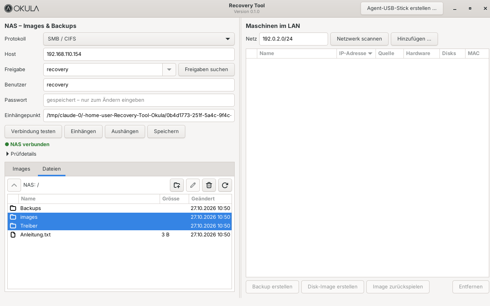
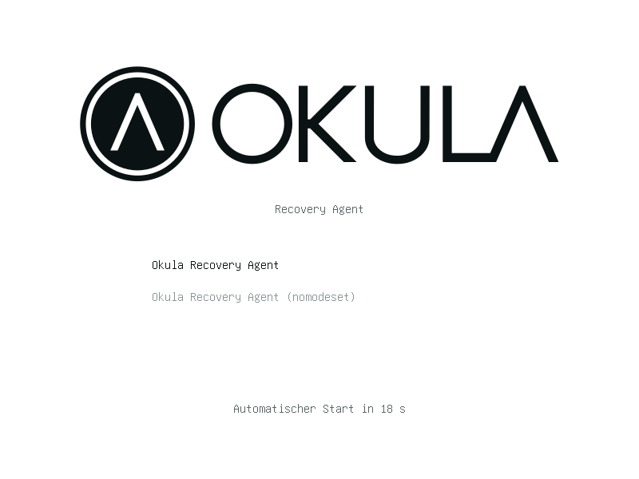
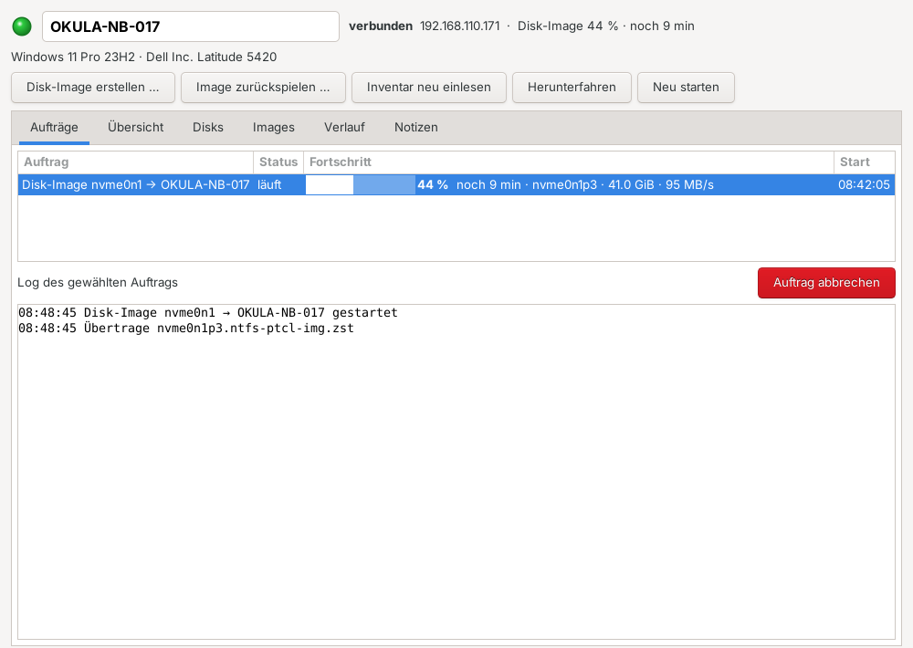
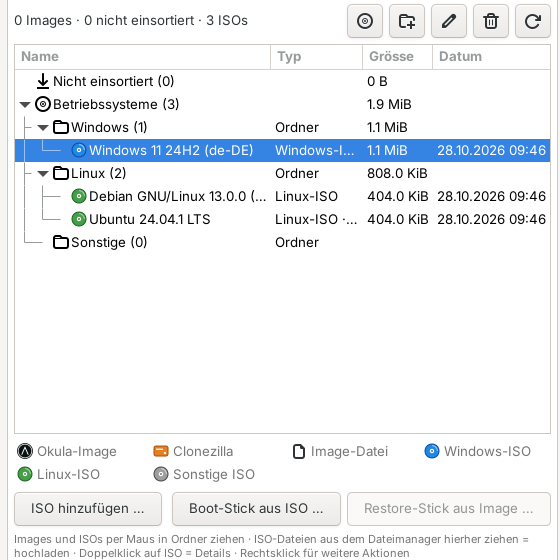
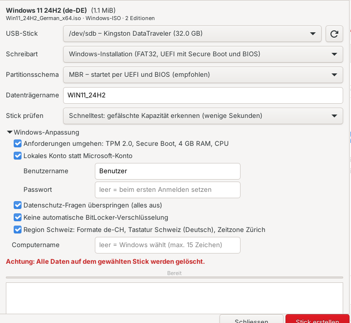
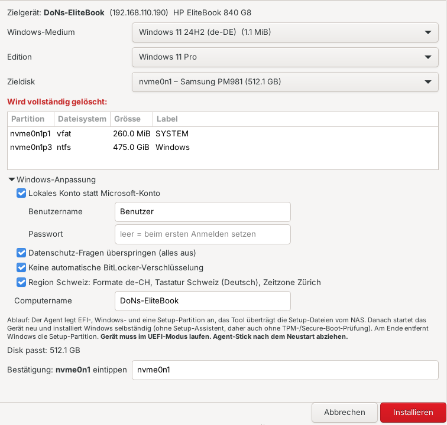
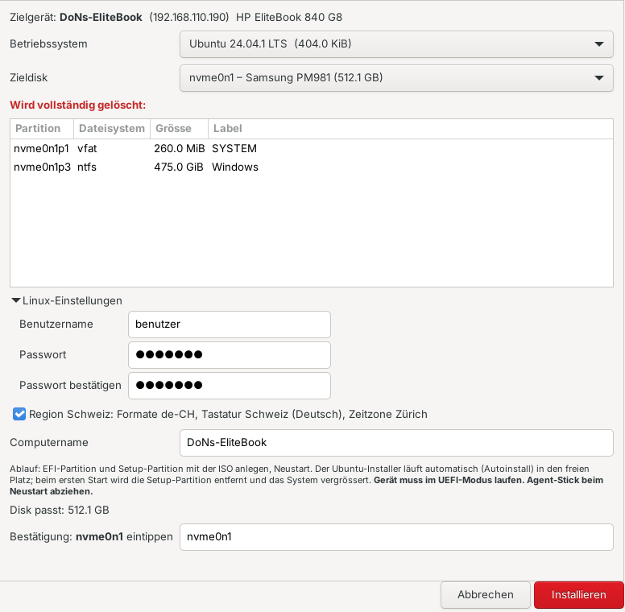

# Okula Recovery Tool – Technik und Details

Kurzfassung: [README](../README.md). Bedienung Schritt für Schritt: Hilfe im Tool (F1).

Backups und Disk-Images von Maschinen im LAN, gespeichert auf einem NAS.
Server: Debian 13 + Xfce, Python 3 + GTK 3.
Bugs, Änderungen, Ideen und Entscheidungen: [docs/AENDERUNGEN.md](AENDERUNGEN.md) · spontane Notizen: [docs/EINGANG.md](EINGANG.md).



Schreibweise in README, Hilfe und Oberfläche: Handbuch-Stil ohne Anrede, Schritte im Infinitiv; Begriffe wie in der
Oberfläche (Disk, Zieldisk, Datenträger für USB, Windows-Schlüssel, Agent-Stick).

- **Menüleiste** (Beschriftungen zentral in `MENU_LABELS`, `okula_recovery/ui.py`):
  - **Menü:** NAS-Verbindung … (Ctrl+N), Einstellungen … (Bandbreite, Automatisierung, Garantie-Abfrage), Agent-USB-Stick erstellen …, Inventar exportieren (CSV/PDF) …, Einstellungen exportieren / importieren …, Beenden
  - **Tools:** Gerät öffnen (Ctrl+O), Disk-Image erstellen, Image zurückspielen, OS installieren, Backup erstellen, Backup zurückspielen, Ordner senden, Inventar neu einlesen, Restore-Stick aus Image, ISO hinzufügen, Boot-Stick aus ISO, Netzwerkstart (PXE), Images aktualisieren (F5)
  - **Extras:** USB klonen, USB formatieren, Demo-Gerät (Vorführung), Demo: nächster Auftrag mit Fehler, Demo-Daten zurücksetzen
  - **Hilfe:** **So funktioniert das Tool** (F1, siehe [Hilfe](#hilfe-f1-und-tastenkürzel)), Tastenkürzel, Über
- **Links (Geräte):** Alle Geräte, die je mit dem Agent-Stick gebootet wurden, in einer Ordnerstruktur. ● grün = verbunden, ● rot = nicht verbunden (Erklärung auch unter Hilfe → So funktioniert das Tool); dazu Status, Betriebssystem, zuletzt verbunden und IP. Details siehe [Geräte](#geräte).
- **Rechts (NAS):**
  - **Statuszeile:** ● grün = NAS verbunden, ● rot = nicht verbunden bzw. nicht eingerichtet. Daneben der freie Speicher: grün, wenn genug frei ist; rot, wenn weniger als 100 GB frei sind. Das Tool prüft den Status beim Start und danach alle 30 s.
  - **Reiter:** *Images* (Ordnerbaum, siehe unten), *Dateien* (Dateiverwaltung) und *Backups* (alle Datei-Backups).
- **NAS-Verbindung einrichten:** Menü → NAS-Verbindung … oder das Zahnrad in der Statuszeile. Das Fenster enthält Protokoll, Host, Freigabe (mit „Freigaben suchen“), Benutzer, Passwort, Einhängepunkt, die Knöpfe Verbindung testen, Einhängen, Aushängen und Speichern sowie die Prüfdetails.

## Server-Installation (Debian 13)

```bash
sudo apt install git
git clone https://github.com/donsimm/Recovery_Tool_Okula.git recovery_tool_okula
cd recovery_tool_okula
git checkout claude/blissful-goldberg-mo3xda   # bis zum Merge
sudo ./install.sh --autostart
```

`install.sh` installiert die Pakete, kopiert das Tool nach `/opt/okula-recovery` (gehört root), legt die Root-Helfer (`okula-make-stick`, `okula-nas-mount`, `okula-warranty` in `/usr/local/sbin`) samt sudo-Regel für den angemeldeten Benutzer an, erstellt den Menüeintrag und mit `--autostart` den Start nach dem Login. Dazu kommen die Grundlage für virtuelle Maschinen und die Netzwerkbrücke `br0` (siehe [Virtuelle Maschinen – Grundlage](#virtuelle-maschinen--grundlage)).

**`install.sh` am Server selbst ausführen**, nicht aus der Ferne (SSH): Beim Einrichten der Netzwerkbrücke ist der Server einige Sekunden offline; misslingt sie, stellt das Skript die alte Verbindung nach 45 s wieder her. `sudo ./install.sh --no-bridge` überspringt die Brücke (VMs haben dann kein Netzwerk im LAN). Nach der ersten Installation mit VM-Paketen einmal ab- und wieder anmelden (Gruppe `libvirt`).

Starten: Menü → System → *Okula Recovery Tool* oder `cd /opt/okula-recovery && python3 -m okula_recovery`.
Update: im Repo `git pull`, dann wieder `sudo ./install.sh`.

### Firewall

Nur nötig, wenn auf dem Server eine Firewall läuft. Prüfen mit `sudo nft list ruleset` (leer = nichts zu tun).
Eingehend freigeben:

| Wann | Port | Wofür |
|---|---|---|
| immer | UDP 47811 | Beacons der Agents – sonst findet das Tool die Geräte nicht |
| nur Netzwerkstart | UDP 67, 69, 4011 | Proxy-DHCP und TFTP |
| nur Netzwerkstart | TCP 47813 | HTTP-Dienst für den Agent-Teil |

Beispiel mit ufw: `sudo ufw allow 47811/udp`, für den Netzwerkstart zusätzlich `sudo ufw allow 67,69,4011/udp && sudo ufw allow 47813/tcp`.
Die Steuer- und Datenverbindung zum Agent (TCP 47812, TLS 1.3 mit PSK) baut der Server selbst auf – dafür ist eingehend nichts nötig.

### NAS einrichten (z. B. Synology)

Im NAS (Synology DSM: Systemsteuerung):
1. **Freigegebener Ordner** anlegen, z. B. `recovery`.
2. Eigenen **Benutzer** anlegen (nicht den Admin) und ihm Lese-/Schreibrecht nur auf diese Freigabe geben.
3. **Dateidienste → SMB** aktivieren, Mindestversion SMB2 (Standard in DSM 7).

Im Tool unter Menü → NAS-Verbindung …:
1. Host (IP des NAS), Benutzer und Passwort eingeben.
2. **Freigaben suchen**, dann die Freigabe aus der Liste wählen.
3. **Einhängen**. Bei Erfolg zeigt die Statuszeile rechts „● NAS verbunden“, und das Tool listet die Images.

Das Passwort speichert nur der Root-Helfer, in `/etc/okula-recovery/nas.cred` (root, `0600`). Es steht nie in der Konfiguration oder in Prozess-Argumenten. Nach dem nächsten Start hängt das Tool das NAS automatisch wieder ein. Fehlermeldungen von `mount` und `smbclient` werden als Hinweis angezeigt, etwa bei einem falschen Passwort, einer fehlenden Freigabe oder einer unpassenden SMB-Version.

Für NFS als Freigabe den Exportpfad angeben (z. B. `/volume1/recovery`) und im NAS die IP des Servers erlauben.

**NAS-Webseite öffnen:** Knopf im Fenster NAS-Verbindung (neben „Verbindung testen“) und kleines Symbol in der NAS-Statuszeile. Öffnet die Weboberfläche des NAS im Browser, z. B. Synology DSM unter `https://<Host>:5001`. Protokoll und Port stehen im NAS-Fenster (Zeile „NAS-Webseite“: https 5001 oder http 5000). Ohne Host ist der Knopf ausgegraut. Der Browser startet immer als normaler Benutzer.

### Images in Ordner einsortieren

Der Reiter *Images* zeigt einen aufklappbaren Baum:
- **Nicht einsortiert** steht ganz oben, neueste zuerst. Hier landen neue Images und alle, die noch in keinem Ordner liegen, auch bestehende Clonezilla-Images.
- **Eigene Ordner** mit bis zu **3 Ebenen**, z. B. *Standort › Abteilung › Gerät*. Anlegen, Umbenennen und Löschen über die Knöpfe oder per Rechtsklick. Ein Ordner lässt sich nur löschen, wenn er leer ist.
- **Icons:** OKULA-Emblem = mit diesem Tool erstelltes Image, orange Disk = Clonezilla-Image, Datei-Symbol = sonstiges Image (einzelne Image-Datei `.img`, `.dd` …). Eine Legende steht unter dem Baum (Okula-Image, Clonezilla, Sonstiges Image, Windows-ISO, Linux-ISO, Sonstige ISO).
- **Restore-Stick aus Image …:** Der Knopf steht unter dem Baum und ist aktiv, sobald ein Okula- oder Clonezilla-Image gewählt ist.
- **Einsortieren per Maus:** Ein Image auf einen Ordner ziehen oder zurück auf „Nicht einsortiert“. Ganze Ordner lassen sich ebenfalls in einen anderen Ordner ziehen, ohne die 3 Ebenen zu überschreiten. Rechtsklick → „Nach ‚Nicht einsortiert‘“ geht auch.

Die Ordner sind echte Ordner auf dem NAS unter `Archiv/`, z. B. `Archiv/Zürich/Buchhaltung/PC-Buchhaltung/<Image>`. Verschieben ist ein Umbenennen auf derselben Freigabe und geht auch bei grossen Images sofort. Nicht einsortierte Images liegen unter `images/` (bzw. bei Clonezilla dort, wo sie abgelegt wurden).

### Dateien auf dem NAS verwalten

Rechts gibt es zwei Reiter:
- **Images:** Alle gefundenen Images. **Löschen** entfernt das gewählte Image.
- **Dateien:** Dateiverwaltung der Freigabe. Doppelklick öffnet einen Ordner, ↑ oder Backspace führt eine Ebene zurück. Dazu kommen **Neuer Ordner**, **Umbenennen** (F2) und **Löschen** (Entf, mit Mehrfachauswahl).
- **Auf das NAS kopieren:** Dateien und ganze Ordner – z. B. **Clonezilla-Images** von einer externen Platte – aus dem Dateimanager in den Reiter *Dateien* ziehen (auf einen Ordner = dorthin, sonst in den offenen Ordner) oder über den Knopf **Hochladen** (Dateien … / Ordner …). Kopiert wird im Hintergrund mit Fortschritt, Tempo, Restzeit und Abbrechen; vorher prüft das Tool Platz und Namen (SMB-taugliche Zeichen). Bestehendes wird nie überschrieben („Name (2)“). Jeder Eintrag entsteht zuerst als versteckter `.Name.partial` und wird erst vollständig umbenannt – ein Abbruch hinterlässt nichts Halbes. Links werden übersprungen. Ein kopiertes Clonezilla-Image erkennt das Tool und zeigt es im Reiter *Images*.

Vor dem Löschen zeigt das Tool Anzahl und Grösse der Dateien und fragt nach. Das Tool hat keinen Papierkorb, gelöschte Daten sind weg. Falls im NAS ein Papierkorb für die Freigabe aktiv ist, greift dieser. Alle Aktionen bleiben innerhalb des Einhängepunkts: `..` und Links nach draussen werden abgewiesen, Links werden nie verfolgt.

Das Tool startet maximiert. **F11** schaltet auf Vollbild ohne Titelleiste und wieder zurück.

**Serverlast:** Oben rechts zeigt das Tool die Auslastung des Servers – CPU, RAM (ohne Cache) und LAN (↓ empfangen, ↑ gesendet) mit Verlauf der letzten Minute, gemessen jede Sekunde aus `/proc`. Maus darüber: Kerne und Last, Swap, Netzwerkkarte und Verbindungsgeschwindigkeit. Ab 90 % wird der Wert rot. Für die Kurven braucht es `python3-gi-cairo` (installiert `install.sh`).

**Spaltenbreiten (Ä-032):** In Geräte, Images, Dateien, Backups und in den Tabellen des Gerätefensters (Aufträge, Disks, Images, Backups, Netzwerk, Verlauf – Breiten für alle Geräte gemeinsam) sind alle Spalten mit der Maus verstellbar; keine Spalte dehnt sich (eine leere Spalte am Ende nimmt den Rest), frühere Mindestbreiten sind weg. Gemerkt werden nur verstellte Spalten (`uikit.remember_columns`, GTK setzt beim Ziehen `fixed-width`) in `~/.config/okula-recovery/spalten.json` (`colstate.py`) – je Rechner, nicht im Export.

**Bandbreite begrenzen (I-030):** Menü → **Einstellungen …** → Rahmen *Bandbreite* (ganz oben): Schalter, Höchstwert 10–10'000 Mbit/s (Standard 300, daneben in MB/s), optional nur im Zeitfenster von/bis mit Tagen (Standard Mo–Fr 07:00–18:00; über Mitternacht zählt der Morgen zum Starttag, von = bis = ganzer Tag). Standard: aus (unbegrenzt). Umsetzung nur im Tool (`bandwidth.py`): ein gemeinsamer Token-Bucket für alle Aufträge, eingehängt in `wire.send_data`/`wire.recv_frame` (nur Daten-Frames) über `wire.set_limiter` – der Agent bleibt unverändert, kein neuer Agent-Stick; beim Empfangen bremst das verzögerte Lesen den Absender über TCP. Portionen von 128 KiB werden der Reihe nach reserviert, dadurch teilen sich parallele Aufträge die Grenze gerecht. Die Grenze wird bei jeder Portion neu gelesen (Änderungen und Zeitfenster wirken sofort). Gilt auch für das Demo-Gerät; NAS-Zugriffe des Servers (Reiter Dateien, Image prüfen) bleiben unbegrenzt. Anzeige: „begrenzt: 300 Mbit/s“ klein in der LAN-Kurve (plus Tooltip), Zeile „Bandbreite begrenzt auf …“ zu Beginn jedes Auftrags-Logs; ändert sich die Grenze, rechnet die Restzeit ab da neu. Gespeichert in `config.json` (`bandwidth`, mit Grenzen beim Laden), im Export enthalten.

## Typischer Ablauf

1. **Gerät erfassen:** Gerät mit dem Agent-Stick starten; es erscheint unter „Neu / nicht einsortiert“. Umbenennen (Name = späterer Computername) und in einen Ordner ziehen.
2. **Zustand sichern:** *Disk-Image erstellen …*.
3. **Master-Image bereitstellen:** vorbereitetes Windows sichern und im Reiter *Images* mit ★ markieren ([Master-Image](#master-image-sysprep)).
4. **Automatisierung einrichten:** Gerätefenster → Reiter *Automatisierung* (Master-Image, Zieldisk, Backup ja/nein, Abschluss), Schalter einschalten. Achtung: Ist das Gerät verbunden, beginnt der Countdown sofort (30 s).
5. **Neu aufsetzen:** Gerät mit Agent-Stick oder Netzwerkstart starten; Stick nie abziehen, solange der Agent läuft (er läuft vom Stick) – erst wenn das Gerät aus ist bzw. beim Neustart der Bildschirm dunkel wird.
6. **Inventar festhalten:** *Menü → Inventar exportieren (CSV/PDF) …*.

## Umzug auf einen neuen Rechner

**Menü → Einstellungen exportieren …** speichert alles in eine Datei (`okula-recovery-<Rechner>-<Datum>.okula.zip`, nur für den Benutzer lesbar):
- `config.json`: NAS-Verbindung und Einstellungen
- `geraete/…`: Geräteverzeichnis mit Ordnern, Verlauf, Notizen und Windows-Schlüsseln
- `agent.key`: Schlüssel der Agent- und Restore-Sticks (empfohlen – sonst alle Sticks neu erstellen)

Nicht enthalten: Images, Backups und ISOs (bleiben auf dem NAS) sowie das **NAS-Passwort** und die **Garantie-Schlüssel** (Dell/HP) – sie liegen nur für root lesbar in `/etc/okula-recovery/nas.cred` bzw. `warranty.cred`. Das NAS-Passwort nach dem Import einmal im NAS-Fenster eingeben, die Garantie-Schlüssel unter Menü → Einstellungen. Die Datei enthält Schlüssel: wie ein Passwort aufbewahren.

Der Export enthält auch die Vorlagen der Automatisierung und die Einstellung „höchstens gleichzeitig“.

**Menü → Einstellungen importieren …** auf dem neuen Rechner (nach `sudo ./install.sh`): zeigt den Inhalt, Teile einzeln wählbar. Vorher sichert das Tool alles, was überschrieben werden könnte, nach `~/.config/okula-recovery/import-sicherung/<Datum>/`. Geräte werden zusammengeführt (gleiche ID: das zuletzt gesehene gewinnt, Ordner aus dem Export; gleiche Hardware mit anderer ID wird zu einem Eintrag vereint). Danach startet das Tool neu. Während Aufträge laufen, ist der Import gesperrt. Manipulierte Dateien (Pfade ausserhalb, falsche IDs, neuere Formatversion) werden abgewiesen.

**Nur NAS:** Im NAS-Fenster gibt es **Exportieren …** (JSON ohne Passwort) und **Importieren …** (liest auch den Gesamt-Export). Der Import füllt das Formular; danach Passwort eingeben und „Einhängen“.

## Agent-USB-Stick

Menü → **Agent-USB-Stick erstellen …**:

**Boot-Menü-Taste je Hersteller** (Tabelle auch im Stick-Dialog und in der Hilfe; Quellen in `okula_recovery/bootkeys.py`):

| Hersteller | Boot-Menü | BIOS | Hinweis |
|---|---|---|---|
| HP | F9 (oder Esc → F9) | F10 | teils mit Fn |
| Dell | F12 | F2 | |
| Lenovo ThinkPad/ThinkCentre | F12 (oder Enter → F12) | F1 | |
| Lenovo IdeaPad/Yoga/Legion | F12 bzw. Fn+F12 | F2 | sonst Novo-Knopf |
| Asus Notebook / Desktop | Esc / F8 | F2 / Entf | |
| Acer | F12 | F2 | F12-Menü erst im BIOS einschalten |
| MSI | F11 | Entf | |
| Gigabyte | F12 | Entf | |
| Fujitsu | F12 | F2 | |
| Medion | F10 (teils F8/F11) | F2 | |
| Toshiba/Dynabook | F12 | F2 | |
| Microsoft Surface | Lautstärke leiser + Ein | Lautstärke lauter + Ein | |
| Apple Mac (Intel) | Option/Alt halten | – | T2: Start von externen Medien erlauben |

Bei erfassten Geräten zeigt das Gerätefenster (Übersicht → **Starttasten**) die passende Taste aus den Inventardaten (DMI-Hersteller und -Modell).


1. Stick einstecken und auswählen. Angeboten werden nur USB- und Wechseldatenträger, nie die Systemdisk.
2. Debian-Live-ISO wählen oder **Herunterladen** klicken. Das Tool lädt das aktuelle `debian-live-…-amd64-standard.iso` von cdimage.debian.org und prüft es gegen `SHA512SUMS`. Die Datei liegt danach unter `~/.cache/okula-recovery/iso`. Ein anderer Mirror lässt sich über die Umgebungsvariable `OKULA_DEBIAN_LIVE_URL` setzen.
3. **Stick vorbereiten**. Der Stick wird gelöscht und so aufgebaut:
   - MBR mit einer FAT32-Partition (Label `OKULAAGENT`), darauf der Inhalt des Live-ISO
   - eigene `grub.cfg`; gebootet wird per UEFI über den GRUB des ISO und per BIOS über `grub-install`
   - Agent als zusätzliches Image `/live/okula-agent.squashfs`. live-boot legt es über das Live-System, so sind Agent, systemd-Dienst und Banner beim Booten direkt aktiv. Auf der Zielmaschine wird nichts installiert, alles läuft im RAM.
   - Tastatur `ch`, Locale `de_CH.UTF-8`, Zeitzone `Europe/Zurich`



**Ablauf an der Zielmaschine:** vom Stick booten (Boot-Menü-Taste siehe Tabelle oben). Der Agent sendet alle 3 s ein Beacon auf **UDP 47811**, und zwar per Broadcast und zusätzlich direkt an die Server-IP aus dem Dialog. Das Tool antwortet, die Konsole zeigt „Verbunden“, und das Gerät erscheint links mit grüner LED (neu: unter „Neu / nicht einsortiert“, siehe [Geräte](#geräte)).

- **Unbekannte IP:** Die IP muss niemand kennen. Die Zielmaschine bekommt im Live-System per DHCP eine neue IP, die alte Netzwerkeinstellung des installierten Systems spielt keine Rolle. Gibt es kein DHCP, setzt der Agent nach etwa 25 s eine feste Link-Local-Adresse `169.254.x.y` (aus der MAC) und meldet sich per Broadcast an `255.255.255.255`. Das Tool antwortet dann ebenfalls per Broadcast.
- **Firewall auf dem Server:** UDP 47811 eingehend freigeben (siehe [Firewall](#firewall)).
- **Secure Boot:** Der Stick nutzt die signierte Boot-Kette des Debian-ISO.
- **Hinweis:** Die Beacons sind nicht authentifiziert. Die spätere Steuerverbindung zum Agent bekommt eine Authentifizierung.

## Netzwerkstart (PXE) – Agent ohne Stick

Registrierte Geräte können den Agent **übers Netzwerk** starten (am Gerät Boot-Menü → Netzwerk/PXE, Taste siehe [Agent-USB-Stick](#agent-usb-stick)), statt vom Agent-Stick. **Nur** Geräte, die schon einmal mit dem Agent-Stick liefen **und** einzeln freigeschaltet sind, bekommen eine Antwort; alle anderen Rechner im Netz bleiben unberührt.

**Einrichten (Tools → Netzwerkstart (PXE) …):**
1. Server-IP wählen (Netz der Geräte) und das Debian-Live-ISO (wie beim Agent-Stick, ggf. **Herunterladen**).
2. **Vorbereiten:** legt Live-System, Agent-Teil (mit Schlüssel, partclone usw.) und die signierten Bootlader bereit (`/var/lib/okula-recovery/pxe`). Nach einem Tool-Update oder neuer Server-IP erneut vorbereiten.
3. Geräte freischalten: Haken in der Liste oder im Gerätefenster (Reiter *Netzwerk*, Zeile *Netzwerkstart*: Schalter Ein/Aus, daneben das Zahnrad zu den PXE-Einstellungen). Der Schalter ist ausgegraut, solange der Netzwerkstart nicht eingerichtet und eingeschaltet ist oder keine Kabel-Netzwerkkarte bekannt ist. Neu erfasste Geräte sind nie freigeschaltet.
4. **Einschalten.** Der Dienst läuft danach auch nach einem Neustart des Servers, bis er ausgeschaltet wird.

**Wie es abgesichert ist:**
- Das Tool vergibt **keine IP-Adressen** und macht kein DNS: `dnsmasq` läuft nur als *Proxy-DHCP* (`dhcp-range=…,proxy`, `port=0`). Der normale DHCP-Server bleibt zuständig.
- Proxy-DHCP und TFTP antworten nur MAC-Adressen in der Freigabeliste (`dhcp-hostsfile` mit Merkmal `okula`, `dhcp-ignore=tag:!okula`); es werden nur kabelgebundene Netzwerkkarten freigeschaltet. Fremde Rechner, die per Netzwerk starten, bekommen keine Antwort (getestet in QEMU).
- Den Agent-Teil (enthält den Agent-Schlüssel) liefert ein eigener HTTP-Dienst (Port 47813) nur aus, wenn die MAC der anfragenden IP (ARP-Tabelle) freigeschaltet ist; er kennt nur zwei feste Dateien. Der Schlüssel liegt nur für root lesbar auf dem Server.
- Bootlader: `shim`, `grub` (signiert – **Secure Boot** darf an bleiben) und `pxelinux` (BIOS) kommen aus den Paketquellen des Servers. Das Tool lädt sie nur herunter und packt sie aus, ohne sie zu installieren – der Bootlader des Servers bleibt unberührt.

**Technik:** UEFI: shim → grub → Kernel/initrd per TFTP; BIOS: pxelinux. Das initrd ist das des Live-ISO plus ein kleines Skript, das live-boot anweist, neben `filesystem.squashfs` auch den Agent-Teil per HTTP zu laden – danach läuft alles wie mit dem Stick. Dienste: `okula-pxe.service` (dnsmasq), `okula-pxe-http.service`; gesteuert über den bestehenden Root-Helfer (`okula-make-stick pxe …`).

**Firewall auf dem Server:** eingehend UDP 67, 69 und 4011 (Proxy-DHCP, TFTP) sowie TCP 47813 (HTTP) freigeben (siehe [Firewall](#firewall)).

**Voraussetzungen am Gerät:** Netzwerkkabel (kein WLAN), Netzwerkstart im BIOS aktiv. Liegen Router/VLANs zwischen Gerät und Server, braucht es eine DHCP-Weiterleitung (IP-Helper) zum Server. Die Geräte brauchen genug RAM für das Live-System (wie beim Stick, ca. 2 GB).

### Fernsteuerung: Wake-on-LAN und „Netzwerkstart zuerst“

Im Gerätefenster, Reiter **Netzwerk** (dort auch Netzwerkstart-Schalter und Netzwerkkarten):

- **Einschalten (Wake-on-LAN):** sendet ein Magic Packet an die Kabel-Netzwerkkarten (Broadcast in die Netze des Servers und an 255.255.255.255, UDP 9 und 7). Am Gerät muss Wake-on-LAN im BIOS/UEFI aktiv sein; das Gerät muss im selben Netz sein (Router leiten Broadcasts nicht weiter).
- **Netzwerkstart zuerst:** Während das Gerät mit dem Agent verbunden ist, setzt der Agent den Netzwerkstart (PXE IPv4) an die erste Stelle der UEFI-Startreihenfolge (`efibootmgr`); die bisherige Reihenfolge merkt sich das Tool zum Zurückstellen. Danach fragt das Gerät bei jedem Start zuerst das Tool:
  - ohne Auftrag (**Startart lokal**): grub bzw. pxelinux starten sofort von der Festplatte weiter (UEFI: zurück an die Firmware → nächster Starteintrag, z. B. Windows),
  - mit **„Beim nächsten Start den Agent laden“** (**einmal Agent**): der Agent startet; sobald er seinen Agent-Teil geladen hat, steht das Gerät wieder auf „lokal“.
  - **Einschalten und Agent starten** = Agent vormerken + Wake-on-LAN – das Gerät meldet sich danach im Tool, ohne dass jemand hingeht.
- Nur UEFI (BIOS-Geräte: Reihenfolge im BIOS-Setup). Windows-Updates können die Reihenfolge zurücksetzen – das Tool prüft sie bei jeder Verbindung (Knopf **Prüfen**) und meldet, wenn das Netzwerk nicht mehr vorne steht. Ist der Server aus, wartet das Gerät kurz aufs Netzwerk und startet dann normal.
- Die Startart pro Gerät setzt der Netzwerkstart-Dienst über je eine kleine Datei pro MAC (grub: `source /okula/mode/<MAC>`, pxelinux: `pxelinux.cfg/01-<MAC>`); getestet in QEMU mit UEFI/Secure Boot und BIOS.

> Für „Netzwerkstart zuerst“ braucht der Agent die neue Funktion: **Agent-Stick neu erstellen** und unter Tools → Netzwerkstart **neu vorbereiten**.

**Netzwerkstart-Protokoll (Ä-034):** Gerätefenster → Netzwerk zeigt, was die Dienste je Gerät gesehen haben (letzte 6 Stunden, alle 5 s neu, solange der Reiter offen ist): Anfrage mit Firmware-Art (BIOS/UEFI aus `PXEClient:Arch`), Antwort bzw. „nicht freigeschaltet“ (`proxy-ignored`), TFTP-Dateien (shim, grub, grub.cfg, Startart, Kernel, initrd bzw. pxelinux), HTTP (Live-System, Agent-Teil) und Fehler. Das Journal liest der Root-Helfer (`okula-make-stick pxe log`, gleiche sudo-Regel), übersetzt wird in `pxelog.py`. TFTP kennt nur IPs – die MAC kommt aus Dateinamen mit MAC (`okula/mode/<mac>`, `pxelinux.cfg/01-<mac>`), der Anfrage auf Port 4011, der HTTP-Meldung (mit MAC) oder der ARP-Tabelle. Geprüft mit echten Abläufen im Labor (dnsmasq 2.91, OVMF + shim/grub, SeaBIOS/iPXE + pxelinux); die Aufzeichnungen liegen in `tests/data/pxelog/`.

**BIOS-Modus (Legacy, B-003):** keine EFI-Variablen – „Netzwerkstart zuerst“ stellt man im BIOS-Setup von Hand ein (Netzwerk/PXE an erste Stelle); der Schalter vermerkt es nur (`devices.bios_mode`: Inventar `platform.uefi`, sonst letzte Prüfung). „Agent beim nächsten Start“ und „Einschalten und Agent starten“ laufen danach über die PXE-Antwort des Tools wie bei UEFI. Netzwerkkarten: nur Kabel mit fester MAC zählen für PXE/WoL (`devices.nic_kind`, `real_mac`); WLAN, Mobilfunk (`ww…`) und zufällige MACs nicht; früher gesehene Karten nur mit fester MAC.

## Virtuelle Maschinen – Grundlage

Konzept, Entscheide und Profile: [VM.md](VM.md) (I-001). Auftrag 1 legt das Fundament; die Oberfläche steht unter [Virtuelle Maschinen im Tool](#virtuelle-maschinen-im-tool-i-001-auftrag-2).

**Pakete** (`install.sh`): `qemu-system-x86 qemu-utils libvirt-daemon-system libvirt-clients ovmf swtpm swtpm-tools virt-viewer`.
Der angemeldete Benutzer kommt in die Gruppe `libvirt` (wirksam nach Ab- und Anmelden) und steuert die VMs ohne sudo
über `virsh -c qemu:///system`. Die VMs laufen im libvirt-Dienst weiter, auch wenn das Tool geschlossen ist.

**Speicherpool** `okula` (Typ dir, `/var/lib/libvirt/images/okula`, Autostart): eine qcow2-Datei je VM
(`<Name>.qcow2`), wächst mit dem belegten Platz. Das libvirt-Standardnetz `default` (NAT, `virbr0`) wird
ausgeschaltet – es würde sonst als eigenes Netz in der Netzwerk-Erkennung auftauchen.

**Netzwerkbrücke `br0`** (`/usr/local/sbin/okula-bridge setup | status | remove`, `okula_recovery/bridge.py`, nur root,
aus `install.sh`): nur mit NetworkManager (sonst Hinweis, nichts geändert). Die Kabel-Schnittstelle der Standardroute
(nie WLAN, z. B. `eno2`) wird Port der Bridge-Verbindung `okula-br0` (ifname `br0`, STP aus, forward-delay 0). `br0`
erhält **dieselbe MAC** wie die Schnittstelle (der DHCP-Server vergibt dieselbe IP) und die IPv4/IPv6-Einstellungen der
bisherigen Verbindung; diese bleibt bestehen, startet aber nicht mehr automatisch. **Rückfall:** Hat `br0` nach 45 s keine
IPv4-Adresse, wird die alte Verbindung wieder aktiviert, die neuen gelöscht und deutlich gemeldet; die Installation
läuft weiter. Idempotent (läuft `br0` schon, passiert nichts). `remove` stellt den alten Zustand her (Angaben in
`/etc/okula-recovery/bridge.json`).

**Netzwerkstart mit `br0`:** Die Server-IP hängt danach an `br0`. `okula-pxe.service` führt vor jedem Start
`python3 -m okula_recovery.pxe refresh` aus und schreibt die dnsmasq-Konfiguration neu, wenn die Schnittstelle nicht mehr
stimmt (`interface=eno2` → `interface=br0`); `install.sh` startet den Dienst neu, wenn er eingeschaltet ist. Beacons
(UDP 47811, an alle Schnittstellen gebunden) und Ping-Scan (über die IP-Adressen) sind nicht an einen
Schnittstellennamen gebunden.

**Modul `okula_recovery/vm.py`** (ohne GTK):
- `VmProfile` mit Firmware (`uefi-sb` | `uefi` | `bios`), TPM, Chipsatz (`q35` | `i440fx`), Disk (`nvme` | `sata`,
  Grösse in GB = 10⁹ Byte, Modellname, Seriennummer, Drehzahl), Netzwerkkarte (`e1000e` | `rtl8139`, MAC), CPU (Kerne,
  Threads, Name), RAM und SMBIOS Typ 0/1/2/3. `PROFILES`: VM-Win11, VM-Legacy, VM-Klein (Tabelle in [VM.md](VM.md)).
- `domain_xml(profile)`: libvirt-XML. UEFI über die Firmware-Auswahl von libvirt (`<os firmware='efi'>`, Merkmale
  `secure-boot`/`enrolled-keys`, bei Secure Boot SMM an), BIOS = SeaBIOS; TPM 2.0 `tpm-crb` mit swtpm; Netzwerk
  `bridge br0`; Start Disk → Netzwerk; Grafik SPICE (nur 127.0.0.1, für virt-viewer) mit Standard-VGA; USB-Tablet;
  kein Memory-Balloon – **kein virtio-Gerät**. SMBIOS per `<sysinfo type='smbios'>` + `<smbios mode='sysinfo'/>`, die
  UUID der VM = SMBIOS-UUID. Das Profil steht als JSON in den Metadaten der VM (`profile_from_xml`).
- **NVMe:** libvirt 11.3 (Debian 13) kennt den Disk-Bus `nvme` erst ab 11.5. Die Disk wird darum als SATA-Disk
  definiert (libvirt verwaltet Datei, Rechte, AppArmor) und per `<qemu:override>` zum QEMU-Gerät `nvme` umgebaut
  (auf `pcie.0`, Steckplatz `0x1b`). QEMU 10.0 hat bei NVMe **keinen Modellnamen** – Windows zeigt „QEMU NVMe Ctrl“.
- **Modellname** der SATA-Disk über `<product>` (libvirt ≥ 11.1), Drehzahl über `rotation_rate` (1 = SSD).
  **CPU-Name** (falls gesetzt) per `-global host-x86_64-cpu.model-id` in `<qemu:commandline>`; sonst der Name der
  Server-CPU. **Gehäusetyp** (SMBIOS Typ 3) lässt sich weder in libvirt noch in QEMU setzen – steht nur im Profil.
  libvirt markiert VMs mit `qemu:override`/`qemu:commandline` als „tainted“ (nur ein Hinweis im Log).
- MAC: `52:54:00:xx:xx:xx`, zufällig, eindeutig gegenüber allen VMs (auch fremden). Seriennummer `VM-…`, UUID zufällig.
- `Virsh`: `create` (Volume per `vol-create-as` qcow2, `define`), `list` (nur VMs des Tools), `state`, `states`
  (alle VMs mit einem `virsh list --all`), `start(name, mode)` mit `normal` (Disk → Netzwerk) | `agent` (einmal
  Netzwerk zuerst) | `iso` (ISO als CD, einmal zuerst) – dafür wird die Startreihenfolge nur für diesen Start
  definiert und gleich wieder zurückgesetzt; ein Neustart in der laufenden VM behält sie, bis `set_boot_runtime` sie
  umstellt –, `shutdown`/`reboot` (ACPI), `poweroff`, `delete` (mit Disk, NVRAM, TPM-Zustand), `set_profile` (nur
  ausgeschaltet; Disk nur vergrössern; UUID und MAC bleiben). Fehler als `VmError` mit deutschem Text.

## Virtuelle Maschinen im Tool (I-001 Auftrag 2)

**Geräteliste:** fester Ordner **„Virtuelle Maschinen“** (`devices.VM_FOLDER`), sichtbar sobald es eine VM gibt oder
libvirt installiert ist. Keine Unterordner, nicht umbenennbar/löschbar/verschiebbar, VMs nicht herausziehbar, echte
Geräte nicht hinein (`DeviceStore` lehnt ab, die Oberfläche zeigt die Meldung). Zeile einer VM: LED wie bei Geräten,
Status statt „nicht verbunden“ der Zustand der VM (`aus`, `läuft`, `läuft – Agent verbunden`), alle 5 s über einen
`virsh list --all` im Hintergrund (`MainWindow.vm_poll`).

**Geräteeintrag** (`DeviceStore.register_vm`, beim Erstellen): Name = VM-Name, `vm = {"name", "profile"}`,
Identität `uuid:<SMBIOS-UUID>` und dieselbe UUID als Agent-ID – der Agent meldet beim ersten Start genau diese
Board-UUID, `match()` findet den Eintrag schon über den Beacon, es entsteht kein zweites Gerät. **Vor-Inventar**
(`vm.pre_inventory`, Feld `provisional`): dmi (Okula, Profilname, Seriennummer, UUID, Gehäuse), cpu, memory, Disk
(Name `sda`/`nvme0n1`, Grösse, Anschluss, Modell, Seriennummer), eine **Kabel**-Karte mit der VM-MAC und platform
(uefi/secure_boot/tpm); der erste Agent-Bericht ersetzt es. Die Kabel-Karte ist nötig: `52:54:00:…` ist lokal
vergeben (`real_mac` = falsch), `netboot_macs` nimmt solche MACs nur aus dem Inventar. Netzwerkstart ist sofort
frei (`netboot = True`, Freigabeliste wird gleich geschrieben), `netfirst = True` (Startart `local`/`once`).

**Startreihenfolge:** Gespeichert ist **Disk → Netzwerk**. „Einschalten und Agent starten“ merkt den Agent vor
(`boot_request`, Startart `once`), schreibt die Freigabeliste und startet erst danach mit `mode="agent"` (einmal
Netzwerk zuerst). Sobald der Agent verbunden ist, stellt das Tool die **laufende** VM auf Disk zuerst um
(`Virsh.set_boot_runtime`: QMP `qom-set` auf `bootindex` von `ua-disk0`/`ua-net0`, QEMU liest die Reihenfolge bei
jedem Neustart neu) – ein Neustart danach (Automatisierung nach dem Zurückspielen) startet das System auf der Disk.
Umgekehrt stellt das Häkchen „Beim nächsten Start den Agent laden“ eine laufende VM auf Netzwerk zuerst.
*Warum nicht fest Netzwerk → Disk wie „Netzwerkstart zuerst“:* Am Server geprüft (06.11.2026) – nach der Startart
„lokal“ beendet sich grub mit `exit` (Erfolg); OVMF startet dann laut UEFI-Regel nicht den nächsten Eintrag, sondern
zeigt das Setup-Menü (auch mit `exit 1`). Ohne Antwort des Netzwerkstarts braucht OVMF über eine Minute (IPv4, danach
IPv6). SeaBIOS startet nach „lokal“ korrekt von der Disk.

**Aktionen** (Rechtsklick auf die VM, Knöpfe im Gerätefenster, gemeinsam aus `MainWindow.vm_actions`; ausgegraut mit
Grund im Tooltip): Einschalten, Einschalten und Agent starten, Von ISO starten … (ISO aus der ISO-Bibliothek; CD mit
`<seclabel model='dac' relabel='no'/>`, damit libvirt die Datei auf dem CIFS-NAS nicht umbesitzt – am Server mit
Debian-Netinst in VM-Win11 und VM-Legacy geprüft), Bildschirm (`virt-viewer -c qemu:///system --wait --reconnect
<Name>`; unter Wayland lässt sich ein fremdes Fenster nicht nach vorne holen, ein offenes Fenster derselben VM wird
darum geschlossen und neu geöffnet), Herunterfahren/Neu starten (mit Agent über den Agent, sonst ACPI), Ausschalten
(hart, Rückfrage), Hardware ändern … (`set_profile`, nur aus; Firmware und Disk-Anschluss mit Warnung; Geräteeintrag
bleibt, Änderung im Verlauf), VM löschen … (rote Rückfrage, nur aus; VM, Disk und Geräteeintrag; Images/Backups auf
dem NAS bleiben). Wake-on-LAN (`wake_device`, Reiter Netzwerk, Rechtsklick) schaltet VMs über libvirt ein; im Reiter
Netzwerk sind Wake-on-LAN und „Netzwerkstart zuerst“ bei VMs ausgeblendet. Alle virsh-Aufrufe laufen im Hintergrund,
`VmError` erscheint als Meldung. Dialoge: `okula_recovery/vm_dialogs.py` (Neue VM mit Prüfung von freiem Platz und
RAM, Hardware ändern, ISO wählen). Das Demo-Gerät bleibt unberührt.

**Leere Disk (Ä-036):** „Einschalten“ einer VM, deren Disk noch nie ein System hatte, fragt zuerst nach
(`vm.blank_disk`: keine Disk im Inventar mit Partitionen oder Partitionstabelle **und** im Verlauf kein erfolgreiches
`install`/`linux`/`restore`/`auto` und kein „VM von ISO gestartet“ – von ISO lässt sich in der VM von Hand
installieren). Knöpfe *Einschalten und Agent starten*, *Von ISO starten …*, *Trotzdem einschalten*
(`vm_dialogs.ask_blank_disk`); gilt für alle VMs.

## Digitaler Zwilling (I-001 Auftrag 3)

**„VM mit dieser Hardware erstellen …“** – Knopf oben rechts im Gerätefenster und Rechtsklick auf ein Gerät; nicht für
VMs und den DEMO-PC, ohne Inventar (dmi + Disks) ausgegraut mit Grund (`MainWindow.twin_why`).

**Profil** (`vm.profile_from_inventory(inv, ServerInfo, Gerätename) -> (VmProfile, Hinweise)`, rein, Tests in
`tests/test_vm_twin.py`): Systemdisk = Disk aus `systems[].disk`, sonst die erste. Firmware aus deren `pttype`
(`gpt` → UEFI/Q35, `dos` → BIOS/i440FX, leer → `platform.uefi`), Secure Boot aus `platform.secure_boot`, TPM 2.0 wenn
`platform.tpm` gesetzt (1.2 → 2.0 mit Hinweis). Disk: Grösse auf ganze GB aufgerundet, `nvme` → NVMe, sonst SATA,
Modell ≤ 40 Zeichen (bei NVMe bleibt „QEMU NVMe Ctrl“), Drehzahl nur aus `rpm`/`rotation_rate` (das Inventar kennt sie
heute nicht → SSD). CPU-Name per `model-id`, Kerne/Threads wie im Gerät, gesamt höchstens Server-Kerne − 2. RAM: das
Inventar meldet `MemTotal` ohne Firmware-Reservat (4 GB → 3,77 GB) – darum auf ganze GB aufgerundet, höchstens
MemAvailable − 4 GB (auf 512 MB, mindestens 1 GB). Netzwerkkarte immer Intel (`e1000e` bei Q35, `e1000` bei i440FX).
SMBIOS Typ 0/1/2/3 genau aus `dmi`, fehlende Werte leer (keine „Okula“-Vorgaben); Gehäusetyp nur im Profil.
BIOS-Datum nur im Format MM/TT/JJ(JJ) (sonst lehnt libvirt ab). **Identität:** Seriennummern (System, Board, Gehäuse
– neues Feld `Smbios.chassis_serial`) → `VM-` + Original (≤ 64 Zeichen), UUID → erste 8 Stellen `0c1a0000` (beim
zweiten Zwilling `0c1a0001` …), Disk-Seriennummer → `VM` + letzte 18 Zeichen, MAC neu; Platzhalter ab Werk
(`devices.placeholder_*`) → neu wie bei neuen VMs. Name `VM-<Gerätename>` (ASCII, `NAME_RE`, eindeutig).
`vm.twin_rows` liefert die Vorschau *Gerät → VM* mit ✔/~/✖.

**Ablauf** (`MainWindow.vm_twin` → `TwinDialog` → `Virsh.create` → `_twin_created`): Geräteeintrag im Ordner
„Virtuelle Maschinen“ mit `vm.twin_of = <Geräte-ID>`, Verlauf beim Original „Zwilling <VM> erstellt“, bei der VM
„Zwilling von <Gerät> (Image …)“, Netzwerkstart frei. Images des Geräts: `device_window.device_images` (gemeinsam mit
dem Reiter Images, neuestes zuerst), Grösse der Quelldisk aus den Image-Metadaten (grösser als die VM-Disk → Fehler im
Dialog). Mit Häkchen: **ein Auftrag** `restore` auf der VM (`_twin_restore`): Agent vormerken, Freigabeliste schreiben,
`Virsh.start(mode="agent")`, bis 300 s auf den Agent warten (Fortschritt „Agent starten (1/3)“), Zieldisk über
`get_info` (Pfad `/dev/sda` bzw. `/dev/nvme0n1`), `jobs.restore_work` mit Prüfung, ohne Anpassen, danach über
`_after_job` herunterfahren (Agent). Fehler: Meldung und Verlauf, VM bleibt. Übersicht der VM: Zeile „Zwilling von“
(Link öffnet das Gerätefenster des Originals).


## Snapshots der VMs (I-001 Auftrag 4)

Begründung und Prüfung am Server: [VM.md](VM.md), Abschnitt „Snapshots“. Kurz: **externe qcow2-Overlays** im
Pool-Verzeichnis, vom Tool verwaltet; libvirts `snapshot-delete` scheitert an AppArmor (`deny … w` für Backing-Dateien),
darum Löschen per block-stream.

**`vm.py`** (ohne GTK):
- `Snapshot` (id, Titel, Zeit, automatisch, eingefrorene Datei, Eltern-ID, `info`; gelesen: Grösse, aktuell) und
  `SnapState` (laufende Nummer, aktueller Snapshot, Liste) – als JSON im Element `okulasnap:snapshots` der
  VM-Metadaten (Namensraum `https://okula.ch/recovery/vm-snapshots/1`). `domain_xml(p, disk_file=…, snapshots=…)`
  schreibt aktuelle Disk-Datei und Liste mit; `Virsh._rebuild` holt beides beim Neu-Definieren (`start` mit Agent/ISO,
  `set_profile`) aus der gespeicherten VM.
- `Virsh.snapshots(name)` (älteste zuerst, Grösse = `vol-info --bytes` Allocation), `snapshot_changes(name)`
  (Änderungen seit dem aktuellen Snapshot), `snapshot_create(name, title, auto=False, info=None, running_ok=False)`,
  `snapshot_revert(name, id)`, `snapshot_delete(name, id, progress)`. Fehler als `VmError` (deutsch).
- Erstellen ausgeschaltet: `vol-create-as <Name>.snap-<n>.qcow2 <Kapazität der Disk> --backing-vol <bisherige Disk>`,
  dann `define`. Laufend (nur `running_ok`, Agent): `snapshot-create-as --no-metadata --disk-only --atomic --diskspec
  sda,snapshot=external,file=…` + `virsh metadata --live --config`. Vor Pool-Abfragen `pool-refresh` (libvirt legt das
  Overlay der laufenden VM ausserhalb des Pools an).
- Zurück: neues Overlay auf der Datei des Snapshots, `define`, bisheriges Overlay `vol-delete`.
- Löschen: für jede Datei, die auf dem Snapshot aufbaut, Hilfs-VM `okula-merge-<Name>` (`helper_xml`: 64 MiB, i440FX,
  nur Disk `hda`, kein Netzwerk) mit `virsh create --paused`, `blockpull hda [--base <Eltern-Datei>]`, Fortschritt aus
  `blockjob --raw` (`cur=`/`end=`), `destroy`; Ergebnis über `vol-dumpxml` (neue Backing-Datei) geprüft, sonst
  `VmError` und der Snapshot bleibt. Danach Liste anpassen, `define`, Datei löschen.
- `delete`: nach `undefine --remove-all-storage` alle Dateien der Liste, die ursprüngliche Disk und übrige
  `<Name>.snap-*.qcow2` löschen (oberste zuerst). `set_profile`: Disk vergrössern mit Snapshots → `VmError`, ohne
  Snapshots wird die oberste Datei vergrössert.
- Texte: `snapshot_title()` („Snapshot TT.MM. HH:MM“), `auto_title(Aktion)` („vor Zurückspielen TT.MM. HH:MM“),
  `history_text()` („Snapshot ‚…‘ erstellt / zurückgesetzt / gelöscht“), `low_space_text()` (unter `LOW_SPACE_GB` = 50).
- `blank_disk` (Ä-036): Verlaufseintrag mit `snapshot_blank` (Zurücksetzen) beendet die Suche – davor gilt der Stand des
  Snapshots. `DeviceStore.add_history(…, **extra)` speichert solche Zusatzfelder.

**Oberfläche:** Reiter **„Snapshots“** im Gerätefenster einer VM (`snapshot_tab.py`): Liste (Titel, Datum,
Automatisch, Grösse, „◀ aktueller Stand“), Zeile „Aktueller Stand: ‚…‘ plus … Änderungen“, Platzwarnung, Fortschritt
beim Löschen; Knöpfe *Snapshot erstellen …*, *Zurück zu diesem Snapshot …* (auch Doppelklick), *Löschen …* – nur bei
ausgeschalteter VM ohne laufenden Auftrag (`MainWindow.vm_why(dev, "snapshot")`), während des Löschens ist die VM
gesperrt (`vm_snap_busy`). Steuerung in `ui.py` (`vm_snapshot_create/revert/delete`, im Hintergrund über `_vm_task`).
Beim Snapshot speichert das Tool in `info` die Disks und Systeme des Inventars und `blank` (Ä-036); beim Zurücksetzen
kommen sie zurück in den Geräteeintrag.

**„Vorher Snapshot“** (nur VMs, Standard an): in *Image zurückspielen* (`RestoreDialog`), *OS installieren*
(`InstallDialog`) und in der Automatisierung (`automation.Settings.snapshot`, Häkchen im Reiter). `ui.vm_auto_snapshot`
macht den Snapshot direkt vor `jobs.start` (bei laufendem Agent, `running_ok`); ein Fehler bricht ab, bevor ein Auftrag
startet: im Dialog „Nicht gestartet: …“, in der Automatisierung Schritt „Vorher Snapshot“ als Fehler (Verlauf, Meldung
am Gerät). `automation.Engine(…, snapshot=…)` ruft ihn im Thread der Automatisierung auf.

## VM-Disk beim Zurückspielen vergrössern (Ä-037)

Ist die Disk einer VM kleiner als die Quelldisk des Images, bietet *Image zurückspielen …* zwei Wege an:
VM-Disk vergrössern (Standard, Image 1:1) oder Image anpassen (Ä-002). Echte Geräte: unverändert (Häkchen
„Für diese Disk anpassen“).

**Entscheidung (`vm.py`, ohne GTK):** `restore_ways(need, grow_info, adapt)` → `RestoreWays` (`grow_gb`, `grow_why`,
`adapt_why`, `adapt_lines`, `default()`, `allowed(way)`, `pending`). `grow_size_gb(need)` = Quelldisk aufgerundet auf
ganze GB (dezimal wie `DiskSpec.size_gb`). `grow_why(snapshots, pool_free, image_used)`: Snapshots →
`SNAPSHOTS_BLOCK_GROW`; frei < belegte Daten + `grow_reserve` (10 %, mind. `GROW_RESERVE_MIN` = 10 GB) → Meldung mit
Zahlen. Die qcow2-Datei ist dünn – Platz braucht nur, was das Zurückspielen schreibt.

**Belegte Daten** (`shrink.used_bytes(image, source_disk)`): partclone-Kopf (belegte Blöcke), Rohkopie (`dd`) = ganze
Partition laut Metadaten, sonst Grösse der Image-Datei; Swap zählt nicht; Kopfbereich dazu. Liest je Partition nur den
Kopf (wie Ä-002), läuft im Hintergrund des Dialogs.

**Virsh:** `pool_free()` (`pool-info okula --bytes` → Available, sonst `free_disk()`), `snapshot_count(name)`,
`power_down(name, timeout=60)` (ACPI-`shutdown`, alle 2 s `domstate`, nach `SHUTDOWN_TIMEOUT` `destroy`; Rückgabe
off/clean/hard, Abbruch → `VmError`), `grow_disk(name, size_gb)` (Profil mit neuer `disk.size_gb` über `set_profile`,
Modellname, Seriennummer, MAC und UUID bleiben; schon gross genug → nichts).

**Dialog (`RestoreDialog`):** neuer Parameter `vm_info` (nur VMs; `ui.start_restore` übergibt
`{"snapshots": snapshot_count, "pool_free": pool_free}`). Bei `disk["size"] < need` startet `_vm_smaller` zwei Prüfungen
im Hintergrund – Ä-002 (`_shrink_state`, wie bisher) und `_grow_state` (vm_info + `used_bytes`) – und zeigt die
Optionsfelder `way_grow`/`way_adapt` (ausgegraut mit Grund im Tooltip, Prüftext mit beiden Wegen). Vorwahl einmal pro
Image/Disk, sobald beide Prüfungen fertig sind (`RestoreWays.default()`). `start_job(…, grow_gb=N)` bzw. `adapt` wie
bisher.

**Auftrag (`jobs.grow_restore_work`, ohne GTK):** ein Auftrag `restore` „VM-Disk vergrössern und zurückspielen
<Image> → <Disk>“ mit den Schritten `vm.GROW_STEPS`: 1. `power_down` – 2. `grow_disk` (Rückruf `grown` → Verlauf
„VM-Disk von 128 GB auf 513 GB vergrössert“) – 3. `start(name, "agent")`, warten bis `TWIN_AGENT_TIMEOUT` auf einen Agent
mit `last_seen` nach dem Einschalten (der alte Agent bleibt bis `AGENT_TIMEOUT` in der Liste), Zieldisk per `get_info`
muss ≥ `grow_gb` GB sein – „Vorher Snapshot“ (`vm_auto_snapshot`) erst jetzt, sonst sperrt er das Vergrössern –
4. `jobs.restore_work` mit dem neuen Agent (Fortschritt über `_StepProgress` als „Zurückspielen (4/4) · …“, Verlauf über
`_after_job` wie beim normalen Zurückspielen). Fehler in 1–3: `failed` → Verlauf „… fehlgeschlagen: … – nichts
zurückgespielt“, Log erwähnt die vergrösserte Disk. `ui._grow_restore` merkt den Agent vor (`boot_request`, wie
`_twin_restore`) und startet den Auftrag erst nach `sync_netboot`.

**Profil VM-Win11:** 256 GB, Modell „Okula NVMe SSD 256GB“ (bestehende VMs bleiben).

## Geräte

Bootet ein Gerät vom Agent-Stick, sammelt der Agent einmal das **Inventar** und das Tool legt das Gerät an bzw. erkennt es wieder.

- **Inventar:** Hersteller, Modell, Seriennummer, System-UUID, Gehäuse, Mainboard, BIOS, Prozessor, RAM, Akku (Zustand in %), Netzwerkkarten (MAC), Disks mit Seriennummer und SMART (Zustand, Betriebsstunden, Temperatur), BitLocker-Partitionen und das **installierte Betriebssystem** (Windows-Version und Computername aus der Registry, Linux aus `os-release`). Dafür hängt der Agent die Partitionen **nur lesend** ein (ext4 `noload`, NTFS `ro`, kein Journal-Replay); auf der Disk wird nichts verändert.
- **Wiedererkennung:** über die System-UUID, sonst Hersteller + Seriennummer, sonst MAC. Nach einem Board-Tausch hilft die Disk-Seriennummer. Eine MAC allein verbindet keine zwei Geräte mit verschiedener UUID (geteilter USB-Netzwerkadapter).
- **Doppelt erfasst?** Einträge mit gleicher System-UUID (z. B. nach einem Import, wenn das Gerät auf dem neuen Server schon vorher gestartet wurde) führt das Tool beim Start und beim Import automatisch zusammen. Von Hand: Rechtsklick auf den doppelten Eintrag → **„Zusammenführen mit …“** → Gerät wählen. Name und Ordner des gewählten Geräts bleiben, Verlauf, Netzwerkkarten, Disks und Notizen werden übernommen, das Inventar kommt vom zuletzt verbundenen Eintrag. **Baugleiche Geräte (B-001):** Platzhalter ab Werk (z. B. UUID `03000200-0400-0500-0006-000700080009`, nur 0 bzw. F; Seriennummern wie „Default string“, „To be filled by O.E.M.“, Disk-Seriennummern aus Nullen) zählen nie als Identität, lokal vergebene MACs (zufällig, Tethering) nicht beim Wiedererkennen. Ist ein passender Eintrag gerade über einen anderen Agent verbunden, entsteht ein eigenes Gerät („Name (2)“); die gemeinsamen Kennungen stehen danach in `geraete/mehrdeutig.ids` und gelten nie mehr als eindeutig. Ein früher vereinter Eintrag wird dabei getrennt (MACs, Agent-ID, Disk des zweiten Geräts entfernt, Inventar neu geholt). Gleiche Agent-ID mit anderer Beacon-MAC führt das Tool als „ID@MAC“ – kein neuer Agent-Stick nötig.
- **Name:** Windows-Computername bzw. Linux-Hostname, sonst Hersteller + Modell. Umbenennen per Stift-Knopf, Rechtsklick oder im Gerätefenster.
- **Ordner:** wie bei den Images, max. 3 Ebenen, per Maus ziehen. Neue Geräte landen oben unter **„Neu / nicht einsortiert“**.
- **Ablage:** lokal auf dem Server unter `~/.local/share/okula-recovery/geraete/` – eine JSON-Datei pro Gerät, Ordner = Ordnerstruktur. Gehört in die Datensicherung des Servers.
- **Getrennt:** Kommt 15 s kein Beacon, wird die LED rot. Das Gerät bleibt in der Liste mit „zuletzt verbunden“. Löschen geht nur bei nicht verbundenen Geräten.



**Gerätefenster** (Doppelklick): Kopf mit LED, Name und Status, Aktionen *Disk-Image erstellen*, *Image zurückspielen*, *Inventar neu einlesen*, die Symbole *Neu starten* und *Herunterfahren* und die Reiter

- **Aufträge:** alle Aufträge dieser Sitzung mit Fortschrittsbalken, Log des gewählten Auftrags und *Auftrag abbrechen*
- **Übersicht**, **Disks** (inkl. SMART), **Images** (Images dieses Geräts auf dem NAS; Doppelklick = zurückspielen), **Verlauf** (erfasst, verbunden/getrennt, Images, Restores, Herunterfahren – mit Ergebnis) und **Notizen**

**Mehrere Aufträge parallel:** Aufträge laufen im Hintergrund, auch auf mehreren Geräten gleichzeitig und auf verschiedenen Disks desselben Geräts. Pro Disk ist nur ein Auftrag möglich. Die Geräteliste zeigt pro Gerät einen Fortschrittsbalken mit Prozent, Auftrag und geschätzter Restzeit (z. B. „▬▬▭ **48 %** Disk-Image · noch 7 min“; bei mehreren Aufträgen „2 Aufträge“ mit Mittelwert und längster Restzeit). Die Restzeit erscheint nach etwa 10 s Laufzeit. Beim Beenden warnt das Tool, solange Aufträge laufen.

> Nach dem Update den **Agent-Stick neu erstellen** – ältere Sticks liefern kein Inventar und können nur einen Auftrag gleichzeitig.

## Inventar, Garantie, Windows 11

Das Tool liest bei jedem Verbinden das Inventar des Geräts (siehe [Geräte](#geräte)). Die Angaben stehen im Gerätefenster unter *Übersicht* und *Disks*; *Inventar neu einlesen* holt sie neu.

### Windows 11

Zeile **„Windows 11“** im Gerätefenster (Übersicht): ✔ tauglich, ✖ nicht tauglich mit Grund (z. B. „✖ TPM 1.2 (2.0 nötig)“), ? unbekannt; auch im Inventar-Export. Nicht in der Geräteliste (bewusst, übersichtlicher). Der Agent erfasst TPM-Version, UEFI/BIOS-Start und Secure Boot; das Tool prüft TPM 2.0, UEFI, RAM ≥ 4 GB, Disk ≥ 64 GB und den Prozessor gegen Microsofts Listen (`okula_recovery/data/win11_cpus.txt`, abgeglichen am 31.10.2026 mit den offiziellen Listen Original/24H2/25H2 für Intel, AMD und Qualcomm; tauglich = Serie steht in einer dieser Listen, Quellen im Kopf der Datei). Ältere Inventare zeigen „?“ – Agent-Stick neu erstellen und Inventar neu einlesen.

Windows 11 auf nicht unterstützter Hardware: siehe [Betriebssystem direkt installieren](#betriebssystem-direkt-auf-ein-gerät-installieren).

### Garantie

Zeile **„Garantie bis“** im Gerätefenster (Übersicht). Grün = gültig, **gelb** = läuft in höchstens 90 Tagen ab, **rot** = abgelaufen. Knopf **„Beim Hersteller abfragen“** fragt per Seriennummer nach: **Dell** (TechDirect Warranty API) und **HP** (HP Warranty API) brauchen einen Schlüssel, einzutragen unter **Menü → Einstellungen → Garantie-Abfrage**; **Lenovo** über die öffentliche Support-Seite, ohne Schlüssel. Ohne Schlüssel, ohne Internet oder bei anderen Herstellern: **„Von Hand …“** (TT.MM.JJJJ). Abgefragt wird nur auf Knopfdruck und einmal automatisch nach dem ersten Erfassen – kein Dauer-Polling. Das Ergebnis bleibt am Gerät gespeichert (gilt 30 Tage als aktuell, danach Hinweis „älter als 30 Tage“); schlägt eine Abfrage fehl, bleibt das alte Datum und der Fehler steht darunter. Die Schlüssel speichert nur der Root-Helfer `/usr/local/sbin/okula-warranty` in `/etc/okula-recovery/warranty.cred` (root, `0600`); er fragt Dell/HP selbst ab und gibt nur das Ergebnis zurück. Die Schlüssel stehen nie in der Konfiguration, im Repo oder im Export und werden im Tool nie angezeigt. Zugang: Dell über TechDirect (APIs → Warranty, Freigabe durch Dell), HP über developers.hp.com (Freigabe durch HP, Schlüssel 90 Tage gültig).

### BIOS (I-032)
Reiter **BIOS** im Gerätefenster. Agent (`biosread.py`, nur stdlib): Grundangaben (DMI `bios_*`, `inventory.platform`, UEFI-Startreihenfolge per efibootmgr) und Einstellungen über die Linux-Schnittstelle `firmware-attributes` (`/sys/class/firmware-attributes/<Treiber>/attributes/<Name>/{type,current_value,display_name,possible_values,…}`; Treiber `hp-bioscfg`, `dell-wmi-sysman`, `think-lmi`, werden per `modprobe` geladen). Befehle `bios` (lesen) und `bios_set` (Wert setzen; Passwort nur für den Aufruf in `authentication/<Rolle>/current_password`, danach gelöscht, nie gespeichert oder protokolliert; erlaubte Werte geprüft). Tool (`biosinfo.py`, `bios_tab.py`): Stand je Gerät in `Device.bios`, Vergleich mit einem anderen Gerät (nur Unterschiede, wichtige Einstellungen zuerst), Suche, CSV, Warnung vor riskanten Änderungen (Boot-Modus, Secure Boot, TPM). Neuer Agent-Stick nötig; ältere Agents melden „Agent zu alt“. Das Demo-Gerät hat ein simuliertes HP-BIOS.

### Hardware-Test (I-023)
Reiter **Hardware-Test** im Gerätefenster, nur lesend. Agent (`hwtest.py`, stdlib + smartctl): Akku (`power_supply`: Kapazität gegen neu, Zyklen), Temperaturen (hwmon/thermal), SMART-Selbsttest kurz/lang (`smartctl -t`, ATA und NVMe, Werte 5/197/198/199 bzw. NVMe Abnutzung/Reserve/Medienfehler), Oberfläche (jeden Sektor lesen, `posix_fadvise` gegen Zwischenspeicher, Lesefehler übersprungen), Arbeitsspeicher (Muster 0x00/FF/55/AA im freien Speicher, Schnell 15 %/max. 1 GiB, Gründlich 60 %/max. 16 GiB), CPU-Last (je Kern ein Prozess, Temperatur, Takt, `thermal_throttle`, Kernel-Meldungen zu Machine Checks), Netzwerk (Daten an das Tool, ohne Bandbreitengrenze). Befehl `hwtest`: Ereignisse step_start/progress/step, Durchsatz über Daten-Frames mit Bestätigung, Abbrechen per `cancel`; die gewählten Disks sind gesperrt. Tool: Auftrag „Hardware-Test“ (`jobs.hwtest_work`), Bericht in `Device.hwtests` (letzte 10), Verlauf, PDF-Prüfprotokoll (`hwreport.py`, reportlab). Neuer Agent-Stick nötig. Folgt: vollständiger RAM-Test mit memtest86+ (I-033).

### Inventar exportieren (CSV/PDF)

**Menü → Inventar exportieren (CSV/PDF) …** oder **Rechtsklick auf einen Ordner** (bzw. „Neu / nicht einsortiert“ oder ein Gerät) → **„Inventar exportieren …“**.

- **Welche Geräte:** alle, ein Ordner (mit Unterordnern) oder markierte Geräte (Häkchen in der Liste).
- **CSV:** eine Datei mit allen gewählten Geräten, UTF-8 mit BOM und Semikolon – öffnet sich in Excel direkt richtig. Mehrere Disks sind mit „ | “ getrennt.
- **PDF:** wahlweise **je Ordner eine Datei** (Titel = Ordnername wie in der Geräteliste, Unterordner bekommen eine eigene Datei, im Kopf steht der volle Ort, z. B. „Zürich › Buchhaltung“) oder **alle gewählten Geräte in einer Datei**. A4 quer, Kopf mit Ordnername und Datum, Tabelle, Seitenzahl; Garantie gelb/rot wie im Tool. Braucht `python3-reportlab` (installiert `install.sh`).
- **Spalten:** Name, Ordner, Hersteller, Modell, Seriennummer, CPU, RAM, Disks (Modell, Grösse, SMART), OS, Win-11-tauglich, Garantie bis, zuletzt verbunden, letztes Image, letztes Backup. Letztes Image/Backup nur, wenn das NAS verbunden ist.
- **Windows-Schlüssel:** „Windows-Schlüssel nicht exportieren“ ist standardmässig an. Ausgeschaltet kommt er nur **maskiert** (`XXXXX-XXXXX-XXXXX-XXXXX-ABCDE`) mit, nie vollständig. Passwörter und Schlüssel des Tools (NAS, Garantie, Agent) sind nie im Inventar.
- Dateinamen: `Inventar_<Ordner>_<Datum>.csv/.pdf` (bei Unterordnern mit vollem Pfad, z. B. `Inventar_Zürich_Buchhaltung_…`), Ziel frei wählbar (Standard: Dokumente).

## Disk-Image erstellen

Links das verbundene Gerät wählen (grüne LED) bzw. im Gerätefenster **„Disk-Image erstellen …“**. Im Dialog Disk und Archivname (vorgeschlagen: Gerätename) wählen und auf **„Image erstellen“** klicken. Der Auftrag läuft im Hintergrund weiter, Fortschritt und Log stehen im Gerätefenster unter *Aufträge*.

- **Disk-Image oder Backup:** Das Disk-Image sichert die ganze Disk: Partitionstabelle, Bootloader und alle Partitionen. Zurückgespielt ist die Maschine wieder genau wie vorher. Ein [Datei-Backup](#datei-backup) sichert nur ausgewählte Ordner.
- **Ablage:** `NAS/images/<Name>/<Datum_Zeit>_<disk>/` mit
  - `okula-image.json` (Metadaten, SHA256 je Datei)
  - `<disk>.sfdisk` (Partitionstabelle) sowie `-head.img` und `-tail.img` (erstes und letztes MiB, also MBR/GPT und Bootloader)
  - pro Partition `<part>.<fs>.pcl.zst` (partclone, nur belegte Blöcke, zstd-komprimiert) oder `<part>.dd.img.zst` für unbekannte und verschlüsselte Partitionen (BitLocker, LUKS): Rohkopie aller Blöcke
  - Swap wird nicht gesichert.
- **Datenfluss:** Der Agent liest die Disk nur und streamt über **TCP 47812** (TLS 1.3 mit PSK) zum Tool. Das Tool prüft die SHA256-Summen und schreibt aufs eingehängte NAS. Der Agent bekommt keine NAS-Zugangsdaten.
- **Abbruch und Fehler:** Während der Arbeit heisst der Ordner `….partial`. Bei Abbruch oder Fehler löscht das Tool ihn wieder, und in der Image-Liste erscheinen nur vollständige Images.
- **Schlüssel:** Das Tool erzeugt beim ersten Stick `~/.config/okula-recovery/agent.key` und bettet ihn in jeden Stick ein. Ein Stick von einem anderen Tool wird abgewiesen. Wer den Stick hat, hat auch den Schlüssel, deshalb die Sticks wie Admin-Werkzeug aufbewahren.
- **partclone auf dem Stick:** `partclone` und `zstd` fehlen im Debian-Live-Image. Das Tool lädt sie beim Erstellen des Sticks mit `apt-get download` aus den Paketquellen des Servers (gleiche Debian-Version) und legt nur die fehlenden Pakete in den Agent-Layer. Dafür braucht der Server Internetzugang.

Tipp für Windows: Vorher vollständig herunterfahren (Shift-Taste gedrückt halten + „Herunterfahren“), sonst meldet partclone ein „inkonsistentes“ NTFS (Schnellstart/Ruhezustand).

## Image zurückspielen

Das Zielgerät vom Agent-Stick booten und links auswählen (oder im Gerätefenster), dann **„Image zurückspielen“**. Ist rechts im Reiter *Images* ein Image markiert, ist es im Dialog schon vorgewählt.

1. **Image wählen:** Der Dialog zeigt die Quelle, also Maschine, Disk, Grösse und Partitionen.
2. **Zieldisk wählen:** Darunter steht, was auf ihr **vollständig überschrieben** wird.
3. **Bestätigen:** Den Disk-Namen (z. B. `sda`) eintippen, erst dann wird **Zurückspielen** aktiv.

**Ablauf:**
1. **Image prüfen (empfohlen, Standard):** Das Tool liest alle Dateien vom NAS und vergleicht die SHA256-Summen. Ein beschädigtes Image wird erkannt, bevor etwas auf die Zieldisk geschrieben wird.
2. **Zieldisk prüfen:** Der Agent kontrolliert, dass die Zieldisk mindestens so gross ist wie die Quelldisk, dass keine Partition eingehängt ist und dass es nicht der Boot-Stick ist.
3. **Tabelle und Bootcode:** Alte Signaturen werden entfernt. Dann schreibt der Agent die Partitionstabelle (`sfdisk`), den MBR-Bootcode und die Bootloader-Lücke vor der ersten Partition. Bei einer grösseren Zieldisk wird die GPT-Backup-Tabelle ans neue Disk-Ende gesetzt.
4. **Partitionen:** `zstd -d | partclone.<fs> -r` schreibt jede Partition zurück, Rohkopien gehen per `dd`. Der Agent prüft dabei nochmals die Prüfsumme jeder Datei.
5. **Swap:** Swap wird mit der gleichen UUID und dem gleichen Label neu angelegt.

**Abschluss:** Gerät herunterfahren, dann den Stick abziehen und einschalten (nie abziehen, solange der Agent läuft).

**Einschränkungen:**
- **Kleinere Zieldisk (Ä-002):** Ist die Zieldisk kleiner (z. B. 512-GB-Image auf 256-GB-SSD), prüft der Dialog sofort, ob die belegten Daten passen, und bietet **„Für diese Disk anpassen“** an. Das Tool erstellt auf dem Server ein **neues Image** daneben (`…_für_256GB`): die grosse Partition (NTFS oder ext2/3/4) wird verkleinert, Partitionen dahinter (z. B. Recovery) rücken ans Ende. Das Original bleibt unverändert, ein angepasstes Image wird wiederverwendet. Zwischenspeicher: Server-SSD (`/var/tmp/okula-recovery`), sonst NAS. Nicht möglich bei BitLocker/Rohkopien, Btrfs/XFS, LVM und MBR mit logischen Partitionen – dann kommt der Grund mit Zahlen. Windows prüft das Laufwerk danach evtl. einmal beim Start. Belegte Daten kommen aus dem partclone-Kopf (`shrink.parse_pcl_header`): Format 0002 schreibt bei grossen Images `usedblocks = 0`, dann gilt das Feld danach (`used_bitmap`, ≤ `totalblock`); sind beide 0 oder unplausibel, lehnt die Prüfung ab („Belegter Platz im Image nicht lesbar – Anpassen nicht möglich“, B-007). Details: [docs/KLEINERE-DISK.md](KLEINERE-DISK.md).
- **Grössere Zieldisk:** Der zusätzliche Platz bleibt unpartitioniert. Unter Windows lässt sich die Partition danach in der Datenträgerverwaltung erweitern.
- **Abbruch:** Ein Abbruch während des Schreibens hinterlässt eine unvollständige Zieldisk; brauchbar ist sie erst nach einem vollständigen Durchlauf.
- **Gleiche Hardware:** Am besten zurück auf dieselbe oder baugleiche Hardware. Bei anderer Hardware braucht Windows unter Umständen andere Treiber.

### Clonezilla-Images zurückspielen

Bestehende Clonezilla-Images (Modus „savedisk“) erkennt das Tool automatisch und zeigt sie rechts in der Image-Liste und im Dialog „Image zurückspielen“ – mit der Kennzeichnung **[Clonezilla]**, bei mehreren gesicherten Disks mit einem Eintrag pro Disk. Den Image-Ordner einfach auf die NAS-Freigabe kopieren, Unterordner sind erlaubt.

- **Unterstützt:** partclone-Images aller Dateisysteme (`sda1.ntfs-ptcl-img.gz.aa …`) mit der Kompression gzip, zstd, bzip2, xz, lz4 oder lzop, gesplittet (`.aa`/`.ab`, `.aaa` …) oder nicht. Dazu Rohkopien (`dd-ptcl-img`), Swap (UUID/Label aus `swappt-*.info`), Partitionstabelle (`*-pt.sf`), MBR und die „hidden data“ nach dem MBR.
- **Prüfung vor dem Schreiben:** Clonezilla speichert keine Prüfsummen. Das Tool entpackt deshalb jedes Partitions-Image auf dem Server und prüft es mit `partclone.chkimg` (interne Prüfsummen von partclone), Rohkopien über die CRC der Kompression. Ein beschädigtes Image wird erkannt, bevor die Zieldisk angefasst wird.
- **Grösse:** Die Zieldisk muss mindestens so gross sein wie die Quelldisk (aus `*-pt.parted`).
- **Nicht unterstützt** (wird im Dialog mit Grund gemeldet): LVM, sehr alte Images mit ntfsclone/partimage (`*.ntfs-img`), Images einzelner Partitionen (Modus „saveparts“).
- **Agent-Stick:** Für gzip-, lz4- und lzop-Images liefert der Stick `pigz`, `lz4` und `lzop` mit, falls sie im Live-System fehlen. Dafür den Stick einmal mit dem aktuellen Tool neu erstellen.

### Fortschritt am Agent und Herunterfahren

- **Am Bildschirm der Zielmaschine:** Während Disk-Image oder Zurückspielen zeigt der Agent einen Fortschrittsbalken mit Prozent, Partition, Geschwindigkeit und Restzeit, danach eine Abschlussmeldung:
  ```
    Image wird auf /dev/sda zurückgespielt – Maschine nicht ausschalten
    [==============>               ]  47 %  sda3  98 MB/s  noch ca. 6 min
  ```
- **Image-Prüfung im Tool:** Beim Zurückspielen zeigt der Agent schon während der Prüfung einen Balken („Image wird im Tool geprüft … – gleich wird zurückgespielt“). Schlägt die Prüfung fehl, erscheint das auch am Agent-Bildschirm.
- **Status-Spalte im Tool:** Die Geräteliste zeigt pro Gerät, was gerade läuft, etwa „Image prüfen 37 %“, „Zurückspielen 52 %“, „Disk-Image 10 %“, „Inventar wird gelesen …“, „bereit“ oder „nicht verbunden“.
- **Danach herunterfahren:** In beiden Dialogen gibt es das Häkchen „Maschine danach herunterfahren“. Es greift nur, wenn der Auftrag erfolgreich war.
- **Symbole „Neu starten“ und „Herunterfahren“:** rechts unter der Geräteliste und im Gerätefenster (Systemsymbole `system-reboot`/`system-shutdown`, Name als Tooltip), mit Rückfrage. Im Menü Tools gibt es dafür keinen Eintrag mehr. Nach dem Auftrag wird nur heruntergefahren, wenn auf dem Gerät kein weiterer Auftrag läuft. Während ein Auftrag läuft, lehnt der Agent das Herunterfahren ab. Auf seinem Bildschirm meldet er „Maschine wird in 5 s heruntergefahren“.

## Master-Image (Sysprep)

Ein Master-Image ist ein vorbereitetes Windows für viele Geräte. Beim Zurückspielen bekommt jedes Gerät seinen eigenen Namen, seinen Windows-Schlüssel und auf Wunsch Region Schweiz und ein lokales Konto. Ausführliche Anleitung: [docs/MASTER-IMAGE.md](MASTER-IMAGE.md).

**Vorbereiten (am Referenzgerät):**
1. Windows frisch installieren. Beim ersten Einrichtungsbildschirm **Ctrl+Shift+F3** drücken – Windows startet im **Audit-Modus** (ohne Benutzer).
2. Updates, Treiber und Programme installieren. Kein Microsoft-Konto, keine Domäne. BitLocker ausschalten.
3. Sysprep als Administrator starten: `C:\Windows\System32\Sysprep\sysprep.exe /generalize /oobe /shutdown`
4. Windows **nicht mehr starten**, direkt mit dem Agent-Stick starten und *Disk-Image erstellen …* (Name z. B. „Master-Win11-2026-10“).

**Im Tool:**
- **Markieren:** Rechtsklick auf das Image → **„Als Master-Image markieren“** (bzw. „Master-Markierung entfernen“). Die Liste zeigt „★ Master“. Die Markierung ist die Datei `okula-master.json` im Image-Ordner (Okula- und Clonezilla-Images).
- **Anpassen:** Im Dialog „Image zurückspielen“ ist bei einem Master-Image **„Danach anpassen“** vorgewählt: Gerätename (aus dem Tool), Windows-Schlüssel (hinterlegt oder aus dem BIOS), optional Region Schweiz und ein lokales Konto (Passwort beim ersten Anmelden – wird nirgends gespeichert).
- **Wie:** Nach dem Zurückspielen hängt der Agent die Windows-Partition ein und legt `Windows\Panther\unattend.xml` ab. Windows richtet sich beim ersten Start damit ohne Fragen ein. Ob das Image generalisiert ist, erkennt der Agent an `Windows\Setup\State\State.ini` (`IMAGE_STATE_GENERALIZE_RESEAL_TO_OOBE`). Ein nicht generalisiertes Windows wird **nicht** verändert (Hinweis im Log). Linux bekommt den Hostnamen (`/etc/hostname`, `/etc/hosts`).
- Ein Image eines UEFI-Geräts läuft nur auf UEFI-Geräten.

## Betriebssysteme (ISOs) und Boot-Sticks

Rechts im Reiter *Images* steht der Ast **„Betriebssysteme“**. Das Tool legt dafür auf dem NAS `OS/Windows`, `OS/Linux` und `OS/Sonstige` an; darunter sind eigene Ordner möglich (insgesamt max. 3 Ebenen).

- **ISO hinzufügen …** (Knopf, Rechtsklick oder Tools-Menü) oder ISO-Dateien aus dem Dateimanager auf den Baum ziehen. Das Tool kopiert sie aufs NAS, berechnet dabei die SHA-256-Summe und ordnet sie nach Windows / Linux / Sonstige ein. Auf einen Ordner gezogen landen sie dort. Auch Disk-Abbilder (`.img`, `.img.xz/.gz/.zst/.bz2`) gehen.
- **Erkennung** ohne Einhängen: Windows-ISOs über das UDF-Dateisystem und die Beschreibung der `install.wim/esd` (Produkt, Version wie 24H2, Sprache, alle Editionen), Linux über `.disk/info` bzw. `.treeinfo` (Ubuntu, Debian, Fedora …). Ob eine ISO per UEFI, BIOS oder als Hybrid (DD) startet, steht in den Details.
- **Details und Prüfsummen** (Doppelklick): Editionen, Boot-Arten, MD5/SHA-1/SHA-256/SHA-512 und ein Feld zum Vergleichen mit der Prüfsumme von der Herstellerseite (grün/rot).
- Verschieben per Maus zwischen OS-Ordnern, Umbenennen, Löschen wie bei den Images.



**Boot-Stick aus ISO …** (Funktionen wie Rufus):



| Schreibart | Für | Ablauf |
|---|---|---|
| Windows-Installation | Windows 10/11 | MBR (UEFI + BIOS) oder GPT (nur UEFI), FAT32. Eine `install.wim` über 4 GB wird in `install.swm`-Teile gesplittet (von Windows-Setup unterstützt). UEFI startet den signierten Microsoft-Bootloader – **Secure Boot funktioniert**. BIOS startet über GRUB → bootmgr. |
| Abbild 1:1 (DD) | Linux-Hybrid-ISOs, Disk-Abbilder | Schreibt das Abbild direkt (auch komprimiert), löscht alte Partitionstabellen inkl. GPT-Kopie am Ende, danach **Lesevergleich** (SHA-256). |
| Dateien kopieren | UEFI-ISOs ohne Hybrid-Bootsektor | FAT32, nur UEFI. |

- **Stick prüfen** vor dem Schreiben: *Schnelltest* (Standard, Sekunden) erkennt **gefälschte Sticks**, die mehr Kapazität melden als vorhanden; *Vollständig* schreibt und liest alle Blöcke (badblocks, dauert lange).
- **Windows-Anpassung** (`autounattend.xml` auf dem Stick): optional **„Auch für nicht unterstützte Hardware“** (TPM 2.0, Secure Boot, RAM, CPU nicht prüfen – standardmässig **aus**, Einschalten nur nach Bestätigung der Microsoft-Hinweise), lokales Konto statt Microsoft-Konto (Name, optional Passwort – sonst beim ersten Anmelden setzen), Datenschutz-Fragen überspringen, keine automatische BitLocker-Verschlüsselung, **Region Schweiz** (Formate de-CH, Tastatur Schweiz-Deutsch, Zeitzone Zürich), optional Computername. Die Windows-Sprache bleibt die des Mediums.
- Der Stick wird über den bestehenden Root-Helfer geschrieben (`sudo okula-make-stick iso-stick …`); ISOs werden nur vom eingehängten NAS (`/mnt/…`) akzeptiert.
- Nicht übernommen von Rufus: ReFS/MS-DOS (unter Linux nicht erstellbar), FFU-Abbilder (nur mit Microsoft DISM), Windows To Go, Download von Windows-ISOs (ISOs selbst hochladen).

### Betriebssystem direkt auf ein Gerät installieren

Gerät mit dem Agent-Stick starten, dann im Gerätefenster (oder Rechtsklick auf das Gerät bzw. auf eine ISO → „Auf Gerät installieren …“) **„OS installieren …“**. Im Dialog Betriebssystem, Zieldisk und Einstellungen wählen, Disk-Namen zur Bestätigung eintippen. **Computername = Gerätename im Tool** (fest; ändern: Gerät umbenennen). Der Dialog zeigt, wie der Name auf dem Gerät ankommt – Windows erlaubt max. 15 Zeichen und nur A–Z, 0–9 und `-` (aus „DoNs_EliteBook_1“ wird „DoNs-EliteBook“), Linux nur Kleinbuchstaben, Ziffern und `-`. Direkt installierbar: **Windows 10/11** (x64), **Ubuntu ab 24.04**, **Debian**, **Fedora** sowie andere Systeme mit Anaconda-Installer (Rocky, Alma – DVD-ISO). Der Dialog zeigt alle ISOs; nicht direkt installierbare sind mit „nur Boot-Stick“ markiert und nennen den Grund (z. B. Nobara/Fedora Live mit Calamares bzw. Live-Installer, Zorin/Kubuntu ohne Autoinstall, 32-Bit-Windows). Das Gerät muss im **UEFI-Modus** laufen; Secure Boot darf eingeschaltet bleiben. Der **Agent-Stick bleibt stecken**: Der Agent setzt BootNext, das Gerät startet 15 s nach „vorbereitet“ einmalig von der Disk; den Stick abziehen, sobald die Installation läuft (vorher nicht – der Agent läuft vom Stick, ohne ihn klappt der Neustart nicht).



**Windows**
1. Der Agent legt auf der Zieldisk an (GPT): EFI (FAT32) · MSR · Windows · **Setup-Partition** (FAT32, am Ende).
2. Das Tool liest die Setup-Dateien direkt aus der ISO auf dem NAS und überträgt sie verschlüsselt (SHA-256 je Datei). Eine `install.wim` über 4 GB teilt der Agent in `install.swm`-Teile.
3. Der Agent setzt per `efibootmgr` den **einmaligen** Start (BootNext) auf die Setup-Partition und startet neu.
4. Die Windows-Setup-Umgebung (von Microsoft signiert) startet über `sources\autounattend.xml` nur `okula\install.cmd`: `dism` spielt die gewählte Edition auf, `bcdboot` richtet den Start ein. Der Setup-Assistent läuft nicht (keine Klicks). Bei einem Fehler öffnet sich das Protokoll `okula\install.log`.
5. Erster Start: Windows richtet sich mit den Anpassungen ein (Konto, Region Schweiz, Computername, Windows-Schlüssel). Danach löscht `SetupComplete.cmd` die Setup-Partition und vergrössert C:.

**Windows 11 auf nicht unterstützter Hardware:** Ist das Gerät laut Inventar nicht Windows-11-tauglich (z. B. TPM 1.2, Prozessor vor 8. Generation), zeigt der Dialog den Grund und die Hinweise von Microsoft (kein Support, Updates – auch Sicherheitsupdates – nicht garantiert, Schäden nicht von der Herstellergarantie gedeckt, Wasserzeichen). „Installieren“ geht erst mit dem Häkchen **„Trotzdem installieren – nicht unterstützt“**. Nach erfolgreicher Vorbereitung steht am Gerät ein Vermerk (Gerätefenster → Übersicht → Windows 11, Verlauf, Inventar-Export). Nie in der Automatisierung. Empfehlung: lieber Gerät ersetzen, Windows 10 mit ESU oder Linux. Quelle: [Microsoft](https://support.microsoft.com/en-us/windows/installing-windows-11-on-devices-that-don-t-meet-minimum-system-requirements-0b2dc4a2-5933-4ad4-9c09-ef0a331518f1).

Neuere Intel-Laptops mit **VMD/RST** zeigen die Disk in der Setup-Umgebung evtl. nicht – dann im BIOS auf AHCI stellen oder den Boot-Stick verwenden.



**Ubuntu Desktop (ab 24.04)**
- EFI-Partition mit den signierten Bootdateien der ISO (shim/grub), die ISO als Datei auf einer Setup-Partition am Disk-Ende, Antworten für den Installer auf einer kleinen Partition `CIDATA`.
- GRUB startet die ISO per Loopback, der offizielle Installer läuft per **Autoinstall** in den freien Platz (`use_gap`): Benutzer, Passwort, Computername, Tastatur Schweiz, Zeitzone Zürich, optional SSH-Server.
- Beim ersten Start entfernt der Dienst `okula-cleanup` die Setup-Partitionen und vergrössert die Systempartition.

**Debian**
- EFI-Partition mit den Bootdateien der ISO und dem **Debian-Netzwerk-Installer** (Kernel/initrd lädt der Server einmal von deb.debian.org, geprüft gegen `SHA256SUMS`, Zwischenspeicher `~/.cache/okula-recovery/netboot`).
- **Preseed** (im zweiten initrd): Partitionierung im freien Platz, Benutzer, Passwort, Computername, Region Schweiz. **Das Gerät braucht Internet**, die Pakete kommen von deb.debian.org.
- **Softwareauswahl wie im Debian-Installer:** Desktop (keiner/Server, GNOME, KDE Plasma, Xfce, Cinnamon, MATE, LXDE, LXQt), Standard-Systemwerkzeuge, SSH-Server, Webserver (Apache). Optional ein **Root-Passwort** (sonst kein Root-Konto, der Benutzer arbeitet mit sudo; mit Root-Konto bleibt er trotzdem in sudo).

**Fedora / Anaconda** (Fedora Everything/Server, Rocky, Alma …)
- Kernel/initrd der ISO auf der EFI-Partition, die ISO als Datei auf einer Setup-Partition am Disk-Ende (`inst.repo`/`inst.stage2=hd:LABEL=OKULASETUP:/fedora.iso`), Kickstart (`inst.ks`).
- Kickstart: Benutzer (Administrator), Passwort, Computername, Region Schweiz, `autopart` im freien Platz, wahlweise Desktop (Workstation/GNOME), optional SSH-Server (sshd aktiv, Firewall offen für SSH).
- DVD-ISO ohne Desktop installiert offline von der ISO; Fedora-Netzwerk-ISO oder Desktop laden die Pakete aus dem Internet.
- Beim ersten Start entfernt `okula-cleanup` die Setup-Partition und vergrössert das System (ext4, btrfs, xfs).

**Zusätzliche Pakete** (alle Linux): im Dialog durch Leerzeichen getrennt, z. B. `htop curl vim`. Der Installer holt sie am Schluss aus dem Internet; unbekannte Namen werden übersprungen, damit ein Tippfehler die automatische Installation nicht anhält (Fedora: `%packages --ignoremissing`).

An der Maschine wird während der Installation nichts gefragt – alles, was nicht im Dialog gewählt ist, wird nicht installiert.

Im Tool ist der Auftrag fertig, sobald das Gerät neu startet; den Rest erledigt der Installer am Gerät. Der Verlauf des Geräts vermerkt die Installation.

### Windows-Schlüssel

- **OEM-Schlüssel aus dem BIOS:** Der Agent liest ihn beim Erfassen aus (ACPI-Tabelle `MSDM`, bei den meisten Geräten ab Windows 8). Nach dem Update den Agent-Stick neu erstellen und *Inventar neu einlesen*.
- **Von Hand:** Gerätefenster → *Übersicht* → *Windows-Schlüssel* → „Hinterlegen …“ (Retail/Volumen; hat Vorrang vor dem OEM-Schlüssel). Angezeigt wird er maskiert, „Anzeigen“ und „Kopieren“ auf Wunsch. Gespeichert lokal auf dem Server bei den Gerätedaten.
- **Bei der Installation** setzt das Tool den Schlüssel ein; Windows aktiviert sich, sobald Internet da ist. Vorgewählt wird die Edition, die zuletzt auf dem Gerät lief – bei einer anderen Edition warnt der Dialog (z. B. Home-Schlüssel und Pro).
- Geräte mit **digitaler Lizenz** (z. B. Gratis-Upgrade auf 10/11) brauchen keinen Schlüssel: die gleiche Edition aktiviert sich nach der Neuinstallation von selbst.

## Datei-Backup

Im Gerätefenster **„Backup erstellen …“** (auch Rechtsklick auf das Gerät oder Tools-Menü). Partitionen werden nur **lesend** eingehängt – am Gerät ändert sich nichts.

**Was sichern** (Reiter im Dialog):
- **Benutzerdaten:** Benutzer pro Windows-/Linux-Partition anhaken. Windows-Kategorien wählbar: Desktop, Dokumente, Bilder, Musik, Videos, Downloads, Favoriten/Links, OneDrive (lokale Kopie), Outlook-PST, Browser-Lesezeichen (Chrome, Edge, Firefox). Linux: ganzer persönlicher Ordner.
- **Ganze Partitionen:** alle Dateien einer Partition.
- **Eigene Ordner:** Dateibaum des Geräts (lädt beim Aufklappen), Ordner/Dateien anhaken.

Immer übersprungen: Auslagerungs-/Ruhezustandsdatei, Papierkorb, *System Volume Information*, Temp-Ordner, Browser-/Programm-Caches, Office-Sperrdateien. BitLocker-Partitionen sind nicht lesbar. **„Grösse berechnen“** zählt vorher Dateien und Grösse und vergleicht mit dem freien NAS-Platz.

**Ablage** auf dem NAS unter `Backups/<Gerät>/<Datum_Zeit>/`:
- **Normale Dateien** (`Dateien/<Partition>/…`) – im Reiter *Dateien* durchsuchbar, einzelne Dateien direkt herausholbar.
- **Archiv** `backup.tar.zst` – kompakt, schneller bei vielen kleinen Dateien.
Dazu `okula-backup.json` (Gerät, Auswahl, übersprungene Dateien mit Grund) und `dateien.tsv` (SHA-256, Grösse, Zeit je Datei). Jede Datei wird bei der Übertragung per SHA-256 geprüft; nicht lesbare Dateien (z. B. defekte Sektoren) werden vermerkt, das Backup läuft weiter.

**Übersicht aller Backups:** rechts Reiter **Backups** (neben *Images* und *Dateien*) – nach Gerät gruppiert, mit Notiz, Inhalt und Grösse, Suche nach Gerät oder Notiz.

**Zurückspielen / herunterladen** (Reiter *Backups* im Gerätefenster oder rechts; Doppelklick oder Rechtsklick):
- Auswahl, was zurück soll (pro Benutzerordner bzw. Partition).
- **Ins installierte System:** Zielpartition wählen, Benutzer zuordnen (z. B. alter Benutzer „Anna“ → neuer Benutzer „Neu“ nach einer Neuinstallation), sonst nach `Okula-Wiederherstellung/…`. Vorhandene Dateien bleiben, die zurückgespielte Datei kommt mit Zusatz „(wiederhergestellt)“ – ausser „überschreiben“ ist gewählt. Windows muss **vollständig heruntergefahren** sein (Shift-Taste gedrückt halten + „Herunterfahren“, ohne Schnellstart); Linux: Besitzer wird der zugeordnete Benutzer.
- **Herunterladen in einen Ordner** auf dem Server oder einem eingesteckten Laufwerk (auch aus dem Archiv).

**Notiz und Löschen:** Beim Erstellen optional eine Notiz eingeben (z. B. „vor Neuinstallation“, Ticketnummer); später ändern über **„Notiz …“** (Reiter *Backups* im Gerätefenster oder rechts, auch per Rechtsklick). Die Notiz steht in `okula-backup.json` auf dem NAS und erscheint in der Liste. **„Löschen …“** entfernt das Backup nach Rückfrage endgültig vom NAS; solange es zurückgespielt oder heruntergeladen wird, ist Löschen gesperrt.

## Ordner an Geräte senden

Vordefinierte Ordner vom NAS per Mausklick auf den **Desktop für alle Benutzer** (`C:\Users\Public\Desktop`) eines Geräts legen.

```
NAS/Verteilen/Software/            fix – wird als ganzer Ordner gesendet
NAS/Verteilen/Test Files/          fix – wird als ganzer Ordner gesendet
NAS/Verteilen/Content/<Projekt>/   Auswahl – gewählte Projekte landen unter Content\<Projekt>
```

- Die Ordner legt das Tool beim Verbinden mit dem NAS an; die Inhalte lassen sich im Reiter **Dateien** pflegen (Drag & Drop).
- **Senden:** Rechtsklick auf das Gerät → **Ordner senden ▸ Software / Test Files / Content …**, oder im Gerätefenster bzw. Tools → „Ordner senden …“ (Auswahl mit Häkchen, auch mehrere Projekte).
- **Erneut senden ersetzt** den Ordner auf dem Desktop. Der Agent schreibt zuerst in einen versteckten Zwischenordner und tauscht erst um, wenn alles angekommen ist – bei einem Abbruch bleibt der alte Stand. Andere Projekte unter `Content\` bleiben.
- **Voraussetzungen:** Gerät läuft mit dem Agent (Stick oder Netzwerkstart), Windows vollständig heruntergefahren (kein Schnellstart/Ruhezustand), keine BitLocker-Verschlüsselung. Links auf dem NAS werden nicht mitgesendet.

## Automatisierung

Erfasste Geräte mit eingeschalteter Automatisierung werden **neu aufgesetzt, sobald sie im LAN auftauchen** (Agent-Stick oder Netzwerkstart). Plan und Entscheide: [docs/AUTOMATISIERUNG.md](AUTOMATISIERUNG.md).

- **Ein/aus:** Häkchen in der Spalte **„Auto“** der Geräteliste oder im Gerätefenster, Reiter **„Automatisierung“**. Ist noch nicht alles eingestellt, öffnet das Häkchen den Reiter und sagt, was fehlt.
- **Ablauf:** 30 s Countdown (im Tool und am Bildschirm des Geräts – **Esc** bricht ab, im Tool „Abbrechen“) → Warteschlange → 1 Backup (Option: Benutzerdaten **oder ganze Disk als Disk-Image**) → 2 Image zurückspielen (**Master-Image** aus den markierten oder **eigenes Image**; vorher vollständige Prüfung) → 3 Anpassen (Gerätename, Windows-Schlüssel, Region Schweiz, Konto – läuft immer) → 4 Ordner senden (Option) → 5 Abschluss (Neustart / Herunterfahren / nichts).
- **Kleinere Zieldisk:** Option in Schritt 2 „Image dafür anpassen“ (Standard ein) – sonst bricht die Automatisierung ab, bevor etwas gelöscht wird.
- **Zieldisk** über die Seriennummer: Steckt eine andere Disk im Gerät, bricht die Automatisierung ab, bevor etwas gelöscht wird.
- **Einmal in 3 Tagen:** Nach erfolgreichem Durchlauf schaltet sich das Häkchen aus und 3 Tage später wieder ein (Option „Nach 3 Tagen wieder einschalten“, Standard ein). Die Liste zeigt z. B. „wieder aktiv in 2 Tagen 5 h“.
- **Fehler:** sofort abbrechen, das Gerät bleibt im normalen Agent-Betrieb. Der Fehler steht in der Liste (rot), im Gerätefenster, im Verlauf und am Bildschirm des Geräts („Automatisierung fehlgeschlagen … Gerät neu starten bzw. neu anschliessen“). Kein automatischer neuer Versuch – erst wenn das Gerät neu angeschlossen wird.
- **Gleichzeitig:** höchstens N Geräte (Menü → **Einstellungen …**, Standard 2); weitere warten („wartet, Platz 2 in der Warteschlange“). **Hauptschalter:** **Stopp-Knopf ■** oben über der Geräteliste, rechts neben den Symbolen – im Normalbetrieb wie die anderen Symbole, **rot solange pausiert** (nochmals klicken = weiter; auch in den Einstellungen). Solange pausiert ist, sind die Häkchen „Auto“ und der Schalter im Reiter ausgegraut.
- **Vorlagen:** Im Reiter Einstellungen als Vorlage speichern (z. B. „Schulungs-PC“) und bei anderen Geräten anwenden. Vorlagen enthalten keine Zieldisk (pro Gerät).
- **Protokoll:** Jeder Schritt steht im Log des Auftrags und im Verlauf des Geräts.

> Agent-Stick bzw. Netzwerkstart nach dem Update **einmal neu erstellen bzw. „Vorbereiten“** – Anpassen, Ordner senden und Countdown brauchen den neuen Agent.

## Demo-Gerät (Vorführung)

**Extras → Demo-Gerät (Vorführung)** startet auf dem Server einen simulierten Agent. In der Liste erscheint **DEMO-PC** (Okula Demo-PC, Windows 11 Pro, 512-GB-SSD, Akku, Netzwerkkarten) wie ein echtes, verbundenes Gerät. Alles lässt sich vorführen: Disk-Image, Zurückspielen, Backup, OS installieren, Ordner senden, Anpassen, Netzwerkstart zuerst, Neustart/Herunterfahren (das Gerät ist dann kurz weg) und die Automatisierung mit Countdown. Ein Auftrag dauert etwa 45 s.

- **Fehler vorführen:** Extras → „Demo: nächster Auftrag mit Fehler“ – der nächste Auftrag bricht bei etwa 40 % ab (roter Balken, Meldung im Log).
- **Sicher:** Der Demo-Agent ersetzt alles, was Disks anfasst, durch Attrappen, läuft als normaler Benutzer und ist nur über 127.0.0.1 erreichbar – andere Geräte im Netz sehen nichts. Die Disk `/dev/demo-nvme0n1` gibt es nicht.
- **Ohne NAS:** Alle Daten des DEMO-PC liegen im lokalen Demo-Speicher `~/.config/okula-recovery/demo/` (images/, Backups/, Verteilen/ mit Beispielprojekten) – auch wenn das NAS verbunden ist, wird dort nichts gelesen oder geschrieben. Reiter Images und Backups zeigen ihn als Bereich **„Demo (lokal, nicht auf dem NAS)“**.
- **Fertige Demo-Images:** „DEMO-Master-Win11“ (★ Master, „Image prüfen …“ ergibt ✔) und „DEMO-Image-beschaedigt“ (ein Byte absichtlich verändert, ergibt ✖).
- **Demo-Image:** Ein Disk-Image vom DEMO-PC ist nur wenige MB gross und als Demo markiert. Es lässt sich nur auf den DEMO-PC zurückspielen; ein echtes Gerät und ein Restore-Stick werden verweigert. Umgekehrt stehen echte Images und Backups beim DEMO-PC nicht zur Auswahl. Alte Demo-Images auf dem NAS (vor Ä-027) werden ausgeblendet und per Rechtsklick zum Löschen angeboten.
- **Zurücksetzen:** Extras → „Demo-Daten zurücksetzen …“ löscht den Demo-Speicher (mit Rückfrage); danach sind nur noch die zwei fertigen Images da.
- **Beenden:** Häkchen wieder entfernen (auch beim Schliessen des Tools). Der DEMO-PC bleibt als „nicht verbunden“ in der Liste und lässt sich löschen. Protokoll: `~/.config/okula-recovery/demo-geraet.log`.

## USB klonen und formatieren

Beide unter **Extras**, für USB-Sticks und externe Festplatten am Server. Angeboten werden nur USB- und Wechseldatenträger, nie die Systemdisk. Beides läuft über den Root-Helfer (`okula-make-stick usb-clone` / `usb-format`), zeigt Fortschritt mit Geschwindigkeit und Restzeit und lässt sich abbrechen.

**USB klonen …** – Quelle (wird nur gelesen) auf Ziel (wird gelöscht):
- **Nur belegte Bereiche (empfohlen):** Partitionstabelle mit gleichen IDs, MBR-Bootcode und Bootloader-Lücke werden übernommen, danach pro Partition nur die belegten Blöcke (`partclone -b`, Gerät → Gerät) für FAT, exFAT, NTFS, ext2/3/4, Btrfs, XFS, HFS+ und F2FS. Andere Partitionen (ohne Dateisystem, verschlüsselt) gehen 1:1. Das Ziel darf kleiner sein, solange alle Partitionen passen; logische MBR-Partitionen gehen auch. Boot-Sticks aus Hybrid-ISOs und Datenträger ohne Partitionstabelle kopiert das Tool automatisch 1:1.
- **Alles 1:1:** jeder Sektor, für verschlüsselte oder unbekannte Datenträger; optional danach Vergleich (Quelle und Ziel ganz lesen).
- GPT auf grösserem Ziel: Reserve-Tabelle ans Ende; der restliche Platz bleibt frei. Unterschiedliche Sektorgrössen (512/4096) werden abgewiesen.
- Danach tragen beide dieselben Kennungen – nicht gleichzeitig am selben Windows-PC anschliessen.

**USB formatieren …**:
- **Dateisysteme:** FAT32, exFAT, NTFS (Schnellformat), ext4, Btrfs, XFS, F2FS, ext3, ext2, HFS+, UDF, FAT16 (bis 4 GB) oder nur leeren. Zu jedem steht im Dialog, wofür es passt. Vorschlag: bis 32 GB FAT32, darüber exFAT. Fehlt ein Programm, ist der Eintrag mit dem Paketnamen ausgegraut.
- **Partitionsschema:** MBR (bis 2 TB), GPT oder ohne Partitionstabelle. Über 2 TB schlägt das Tool GPT vor.
- **Name:** wird nach den Regeln des Dateisystems angepasst (FAT: 11 Zeichen, Grossbuchstaben).
- **Vorher:** nichts, Schnelltest auf gefälschte Kapazität, mit Nullen überschreiben oder vollständiger Test (badblocks).
- Bei Linux-Dateisystemen gehört der oberste Ordner danach dem angemeldeten Benutzer (ohne root beschreibbar).

`install.sh` installiert dafür `exfatprogs` und `ntfs-3g` sowie – falls verfügbar – `btrfs-progs`, `xfsprogs`, `f2fs-tools`, `hfsprogs` und `udftools`.

## Restore-Stick (ein Image, ohne Netzwerk)

Rechts im Reiter *Images* (oder Tools → Restore-Stick aus Image …) ein Okula- oder Clonezilla-Image wählen, auch in Ordnern und **„Restore-Stick …“** klicken. Dann Stick und Debian-Live-ISO wählen und **Stick vorbereiten**. Der Dialog zeigt, wie gross der Stick mindestens sein muss: Image plus etwa 2 GB. Zu kleine Sticks sind markiert.

- **Aufbau:** Partition 1 ist FAT32 (`OKULA-REST`) mit Live-System, Boot-Menü „Okula Restore-Stick“ und Restore-Programm. Partition 2 ist ext4 (`OKULADATA`) mit dem Image unter `image/` und der Beschreibung `okula-restore.json`. ext4, weil Partitions-Images oft grösser als 4 GB sind.
- **An der Zielmaschine:** vom Stick booten. Die Bildschirmführung zeigt das Image und alle Disks der Maschine, mit Modell, Grösse, Partitionen und dem Hinweis, ob eine Disk zu klein ist.
  1. Zieldisk per Nummer wählen.
  2. Zur Bestätigung **den Disk-Namen eintippen**. Ohne Bestätigung wird nichts geändert.
  3. Der Stick prüft das Image (SHA256 bzw. `partclone.chkimg`) und spielt es mit Fortschrittsbalken zurück.
  4. Danach: Enter = herunterfahren, `n` = neu starten, `s` = Kommandozeile.
- **Fehler:** Bei einem Fehler (Lesefehler, beschädigtes Image) zeigt der Stick die Meldung und geht zurück zur Disk-Auswahl.
- **Sicherheit:** Der Stick selbst wird nie als Ziel angeboten. Zu kleine oder eingehängte Disks werden abgelehnt. Es gibt bewusst keinen Automatikmodus.

## Projektübersicht

*Extras → Projektübersicht …* (I-034) zeigt den Projektstand als lokale Webseite in Firefox und sammelt
Rückmeldungen. Module: `projekt.py` (Einlesen, Rückmeldungen-Datei, ohne GTK), `projekt_server.py` (HTTP),
Seite in `okula_recovery/assets/projekt/` (`index.html`, `style.css`, `app.js` – keine externen Dateien/CDNs).

**Datenquelle (nur lesen, bei jedem Laden neu):** `<Projektordner>/docs` – Standard `~/recovery_tool_okula` des
aufrufenden Benutzers (unter sudo: Home von `SUDO_USER`), änderbar unter *Menü → Einstellungen … → Projektordner
(Repo)* (`config.json`: `project_dir`, leer = Standard).
- `TESTS.md`: „## Vorbereitung am neuen Server“ und jede `### …`-Gruppe unter „## Offen – am realen System testen“;
  Zeilen `- [ ]`/`- [x]` samt eingerückter Folgezeilen sind Testpunkte, übrige Absätze/Hinweise Gruppentext.
- `AENDERUNGEN.md`: Tabellen 🐞/🔧/💡 (alle Spalten; Zeilen mit mehr Zellen als der Kopf → „Gemeldet“), Kurzübersicht
  (Zähler, „Als Nächstes“, „Vorschlag Reihenfolge“), „📌 Entscheidungen“ (eingeklappt, nur lesen).
- `UEBERGABE.md`: nummerierte Punkte unter „## Offen und als Nächstes“; `prompts/*.md` ohne `VORLAGE.md`: Titel und `Status:`.
- Inline-Markdown (fett, kursiv, `code`, Links) wird nach dem HTML-Escapen umgesetzt; nur `http(s)`-Links werden
  klickbar. Unbekannte Strukturen werden übersprungen, Lesefehler je Datei oben auf der Seite gemeldet.
- Stand: Zeit des Einlesens und `git log -1` des Projektordners.

**Schlüssel:** Bugs/Änderungen/Ideen = ID (`B-004`); Tests `test:<Abschnittsnummer bzw. vorbereitung>:<sha1>`,
Übergabe `uebergabe:offen:<sha1>` – SHA-1 (16 Zeichen) der ersten 200 Zeichen des Texts ohne Markdown, Leerraum und
Gross/Klein; ein angehängter Vermerk „– ✔ …“ zählt nicht. Prompts `prompt:<Datei>`. Rückmeldungen, deren Schlüssel
nicht mehr vorkommt, zeigt die Seite unter „Rückmeldungen ohne Eintrag“ (gespeicherte Textkopie) – nichts geht verloren.

**Datei:** `~/.local/share/okula-recovery/projekt-rueckmeldungen.json` (ausserhalb von Git, Rechte 0600, unter sudo
Besitzer `SUDO_USER`), atomar geschrieben (Temp-Datei + `os.replace`), bei jedem Zugriff neu gelesen. Defekte Datei →
`projekt-rueckmeldungen.defekt-<zeit>.json`, Neubeginn mit Hinweis auf der Seite. Aufbau:
`{"version": 1, "eintraege": {"<schlüssel>": {"art", "bezug", "text", "haken", "kommentar", "prio_wunsch",
"status_wunsch", "geaendert", "uebernommen"}}, "notizen": [{"id", "art", "text", "erstellt", "geaendert",
"uebernommen"}]}`. `haken`: `ok`/`fehler`/`null`; `status_wunsch`: `als Nächstes`, `zurückstellen`, `streichen`,
`erledigt`. Alle Felder leer → Eintrag entfernt. `uebernommen` setzt nur die Projektleitung (Datum, z. B.
`2026-11-10`); jede Änderung setzt es auf `null`. Übernommene Notizen lassen sich nicht mehr ändern/löschen.

**Sicherheit:** `ThreadingHTTPServer` im Tool-Prozess (Daemon-Thread, endet mit dem Tool), nur `127.0.0.1`, freier
Port; Token `secrets.token_urlsafe(24)` pro Tool-Start als erster Pfadteil, sonst 403. Zusätzlich 403 bei fremdem
`Host`-Header (DNS-Rebinding) und fremder Absenderadresse. Schreiben nur per `POST` mit `Content-Type:
application/json` (≤ 256 KB) auf `api/rueckmeldung` bzw. `api/notiz`; Antworten mit CSP `default-src 'self'`,
`no-store`, `Referrer-Policy: no-referrer`. Keine Schreibzugriffe auf Markdown, kein git-Schreiben. Filter- und
Klappzustand nur im `localStorage` des Browsers.

## Hilfe (F1) und Tastenkürzel

**Hilfe → So funktioniert das Tool** (F1): Anleitung im Handbuch-Stil mit Kapiteln in der Reihenfolge des Arbeitsablaufs – Überblick, Wichtige Begriffe, Erste Schritte, Typischer Ablauf, Gerät verbinden, Netzwerkstart, Geräte verwalten, Disk-Image, Image zurückspielen, Datei-Backup, Master-Image, Automatisierung, Ordner senden, Inventar/Garantie/Windows 11, Windows/Linux installieren, Sticks, USB klonen/formatieren, Images verwalten, Anzeigen, Neuer Rechner, Probleme lösen, Tastenkürzel, Demo-Gerät. **Suchfeld** oben links (oder **Ctrl+F**): zeigt nur Kapitel mit dem Wort und markiert die Treffer gelb; **Esc** leert die Suche.

| Taste | Wirkung |
|---|---|
| F1 | Hilfe |
| Ctrl+F | In der Hilfe suchen |
| Esc | Suche leeren, sonst Hilfe bzw. Dialog schliessen |
| Ctrl+N | NAS-Verbindung |
| Ctrl+O | Gewähltes Gerät öffnen |
| F5 | Images aktualisieren |
| F11 | Vollbild ein/aus |
| Ctrl+Q | Beenden |
| F2 / Entf / Backspace | Reiter *Dateien*: umbenennen / löschen / eine Ebene zurück |

Neue oder geänderte Funktionen bekommen im selben Commit das passende Kapitel in `okula_recovery/help_window.py`; `tests/test_help.py` prüft Markup, Menüeinträge, Querverweise und dass Hilfe und Oberfläche ohne Anrede auskommen.

## Tests

```bash
python3 -m unittest discover -s tests -t .
```
